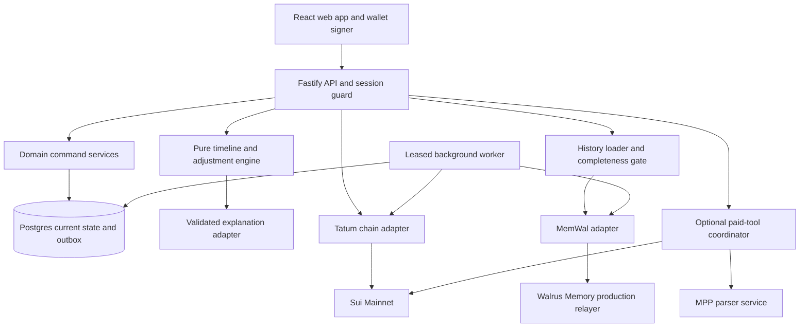

# Runway implementation architecture

Revision: 21 October 2026. Project root: `/home/dotmantissa/hackathons/runway`.

This is the implementation contract for the planned build. It describes intended behavior; it does not assert that code, accounts, Mainnet writes or deployment already exist. [BUILD_PLAN.md](BUILD_PLAN.md) establishes the product, [DESIGN_SPEC.md](DESIGN_SPEC.md) defines the interface, and [IMPLEMENTATION.md](IMPLEMENTATION.md) orders the work. When an older planning paragraph conflicts with this specification, this file governs implementation details. Event rules and explicit user instructions still take precedence.

## 1. Outcomes and boundaries

The complete user journey is: enter confirmed funds and dated commitments, add an invoice, reconcile past receipts, inspect payment timing, run a deadline stress test, review a permitted adjustment, accept it, and recover the same explanation in another session. Every meaningful forecast and accepted correction has inspectable memory provenance.

The submission must demonstrate Consumer Finance utility and a deep Walrus learning loop. Optional agent payments support invoice entry. No custom token, yield product, public wager or custom Move contract is needed. The user's primary wallet never grants the backend transfer authority.

| Priority | Included behavior | Hard boundary |
| --- | --- | --- |
| Core | Original landing page and working responsive app. | Four main application destinations; settings and evidence are utility surfaces. |
| Core | Wallet authentication and isolated sample exploration. | A sample session cannot sign transactions, read another user's private data or trigger unlimited Mainnet writes. |
| Core | Sui USDC plus explicitly confirmed offchain USDC balances. | One currency and chain; no USD conversion, bank scraping or implied full financial coverage. |
| Core | Invoice/expense forms, one CSV import and digest entry. | At most three client sender addresses, eight flexible expenses and 30 history records in the controlled continuity fixture. |
| Core | Four timing scenarios over 14 local calendar days. | History is an estimate; anticipated receipts are never current spendable funds. |
| Core | Minimal total allowed expense reduction. | Fixed bills, already-paid expenses and pending transfers cannot be edited by a proposal. |
| Core | Versioned facts, completed Mainnet memory, corrections and fresh-runtime proof. | Semantic recall does not determine current money or override policy versions. |
| Core | Authenticated Tatum balance and receipt verification. | No silent sponsor fallback; indexing capability is verified before being enabled. |
| Conditional | Paid invoice parser using accepted Sui MPP. | Isolated funded tool wallet; correct 402 protocol and paid-job recovery or omit the feature. |
| Stretch | User-owned memory account flow, scheduled briefs and complete state recovery. | Do not claim user ownership or database-independent recovery from operator namespaces. |

### Financial invariants

1. All authoritative money uses integer atomic units and a canonical coin type.
2. Confirmed available-to-spend excludes unsettled invoices in every view and scenario.
3. Each account, transfer and unpaid commitment is counted at most once.
4. Every adjustment respects user-confirmed caps and keeps fixed commitments intact.
5. No proposal edits financial state until the user accepts its exact current version.
6. A stale balance or conflicting state invalidates acceptance and requires recalculation.
7. A missing receipt means unconfirmed on the monitored rail, not proved unpaid everywhere.
8. Uploaded and indexed memory is distinct from a merely accepted job.
9. Imported events retain both historical event time and actual write time.
10. Synthetic scenario balances cannot enter real-account calculations or signing flows.

## 2. Stack and deployable shape

Use a TypeScript modular monolith with a separately started worker. This keeps transactions and domain rules local while giving durable background work its own process. Do not split into microservices during the hackathon.

| Layer | Default selection | Responsibility |
| --- | --- | --- |
| Workspace | pnpm workspaces, locked versions, Node 22 LTS baseline. | Shared contracts and deterministic builds; confirm runtime meets installed SDK engines. |
| Web | React, Vite, React Router. | Client navigation, accessible forms and custom component styling. |
| Data fetching | TanStack Query. | Server state, typed query keys, bounded refresh and invalidation. |
| Forms | React Hook Form and Zod. | Draft state and contract validation, with server revalidation. |
| UI primitives | Radix Dialog/Popover/Select/Tabs as needed; Lucide React. | Accessible behaviors and one consistent icon family. All styling is Runway's own. |
| API | Fastify on Node, same-origin `/api/v1`. | Authentication, authorization, command transactions, sponsor adapters and web static files. |
| Database | Postgres, Drizzle migrations, `pg` driver. | Current state, versions, command idempotency, jobs, audit and receipt allocations. |
| Worker | Node process from the same server package. | Memory outbox, bounded receipt discovery and optional paid-job recovery. |
| Chain | `@mysten/sui`, native gRPC transport or `@grpc/grpc-js`. | Typed Tatum reads behind one adapter, wallet-compatible transaction data if needed. |
| Wallet | `@mysten/dapp-kit-react` with core instance. | Connect/disconnect and personal-message authentication. No backend custody of user keys. |
| Memory | `@mysten-incubation/memwal`. | Signed production-relayer remember/status/recall calls. |
| Explanation | One structured-output LLM adapter. | Explain validated engine results and cite permitted records; deterministic template fallback. |
| Hosting | Render Docker web service plus worker; Neon Postgres, same region where possible. | Native HTTP/2 support, stable worker lifetime and ordinary managed backups. |
| Verification | Vitest, Postgres integration fixtures, Playwright and axe-core. | Domain invariants, concurrency, sponsor smoke tests and actual browser behavior. |

Hosting selections are implementation defaults, not purchased accounts or deployed resources. Verify Render worker costs against the budget before provisioning. A single non-sleeping Node service with a leased in-process worker is an allowed reduced-cost mode; it uses the same jobs and lease logic. A sleeping free service must not be presented as continuous monitoring. Worker and web never both claim the same job without database leasing.

The landing page ships pre-rendered/static readable HTML and local assets. App routes use a static shell plus authenticated API data. Public sample entry works without a wallet. Wallet SDK, history inspector, charts and optional parser are lazy chunks. Native gRPC and all secrets stay in Node, never in a Vite browser bundle or an edge runtime.

Pin exact package versions after the transport spike and commit the lockfile. Do not paste research commit hashes into package dependencies blindly. Record the tested SDK/relayer versions and proto commit in `docs/integration-compatibility.md` during the build. Avoid the legacy `@mysten/dapp-kit`, which is documented as deprecated and JSON-RPC-only.

### Module and process diagram



### Proposed repository layout

```text
apps/
  web/
    public/brand/                 original logo and icon exports
    public/fonts/                 licensed local WOFF2 files
    src/app/                      router, providers, error boundaries
    src/features/{overview,invoices,plan,activity,settings,onboarding}/
    src/components/               shell, tables, dialogs, timeline, evidence
    src/motion/                   landing orbit and motion preferences
    src/styles/                   tokens, reset, typography, layout
    src/content/                  typed product copy; no scattered strings
  server/
    src/http/{routes,auth,errors}/
    src/services/                 transactional command orchestration
    src/adapters/{tatum,memwal,llm,parser}/
    src/db/{schema,migrations,queries}/
    src/jobs/                     claim, lease, retry and handlers
    src/worker.ts
    src/server.ts
packages/
  contracts/                      Zod API DTOs, error codes and enums
  domain/                         money, dates, forecasts, timeline, optimizer
  fixtures/                       synthetic trajectories with explicit clock
tests/
  integration/                    database/auth/concurrency/adapter contracts
  e2e/                            real browser critical journeys
scripts/                          seed, smoke, replay, evidence export
docs/                             verified build evidence and operations
ARCHITECTURE.md
DESIGN_SPEC.md
IMPLEMENTATION.md
BUILD_PLAN.md
VALIDATION.md
DELIVERY.md
RESEARCH.md
README.md
TASKS.md                           local, ignored recovery checklist
```

`packages/domain` cannot import HTTP, database, wallet, LLM or SDK modules. Server services own transactions; route handlers only validate, authorize, call services and serialize results. Web components cannot implement their own money formulas. Contracts serialize money as strings; server-only types are not exported through browser entry points.

## 3. Domain types, dates and money

```ts
type Atomic = bigint;                 // domain only; JSON uses decimal strings
type LocalDate = string;              // strictly valid YYYY-MM-DD
type ScopeKind = 'personal' | 'sample' | 'live_exercise';
type Scenario = 'promised' | 'history_median' | 'observed_latest' | 'no_receipt';
type HistoryMode = 'none' | 'walrus' | 'postgres';
type EvidenceSource = 'tatum_verified' | 'user_confirmed' | 'synthetic_replay';

interface MoneyDTO {
  amountAtomic: string;
  coinType: string;
  decimals: number;
}

interface PlanningInput {
  schemaVersion: 1;
  stateVersion: number;
  asOf: string;
  localToday: LocalDate;
  timezone: string;
  horizonEnd: LocalDate;
  confirmedFundsAtomic: string;
  reserveFloorAtomic: string;
  expenses: ExpenseDTO[];
  invoices: InvoiceDTO[];
  unmatchedPendingReservations: ReservationDTO[];
}
```

Use native Sui Mainnet USDC:

```text
0xdba34672e30cb065b1f93e3ab55318768fd6fef66c15942c9f7cb846e2f900e7::usdc::USDC
```

This coin type is listed by [Circle](https://developers.circle.com/stablecoins/usdc-contract-addresses). Verify decimals with Tatum/coin metadata during startup; expected native USDC decimals are six. Abort the money adapter if configured and observed metadata disagree. Do not accept a symbol match or bridged token as canonical USDC.

Money input accepts unsigned decimal text with at most six fractional digits. Reject exponential notation, negative user amounts, NaN, infinity, trailing text and excess decimals. Convert by string splitting and zero-padding, never `parseFloat(value) * 1e6`. Domain projected balances may be negative. SQL monetary columns use `numeric(78,0)` with integer/appropriate sign checks; `pg` values remain strings until `BigInt`. Individual chain balances obey their source `uint64` limits; application sums may exceed one source's limit. Formatting groups the integer part as text and renders fractional digits without converting the full amount to `Number`.

Dates are calendar dates, not durations of 86,400,000 milliseconds across daylight-saving changes. Store commitments as Postgres `date`, verified settlement instants as `timestamptz`, and the user's IANA timezone. Convert a settlement instant to the client's agreed invoice timezone, falling back to the account timezone. Freeze that timezone when recording an outcome. All fixtures inject a clock; the 29 October hero remains a dated replay even when a visitor opens it in November.

The default horizon includes today and the following 13 local dates. Show both endpoints. Overdue unpaid expenses and overdue receivables are not dropped when their dates precede today: expenses are opening immediate commitments; unsettled invoices get an overdue label and a conditional arrival floor at today. Calendar arithmetic uses one tested utility module. Changing timezone increments state version and recalculates the view, but does not silently rewrite historical lateness outcomes; correcting an outcome's timezone requires an explicit correction.

## 4. Database contract

All tenant data carries `workspace_id`. Every cross-table foreign key involving tenant data includes the workspace ID. API services receive an authorized workspace from the session, never trust a browser-supplied owner or namespace. UUIDs are generated server-side. Mutations increment a workspace `state_version` in the same transaction as their state changes. Derived history publication does not by itself alter current money; facts/corrections that change the planner do.

| Table | Required columns | Constraints and use |
| --- | --- | --- |
| `users` | `id`, `wallet_address`, `created_at`. | Canonical address unique; wallet controls auth, not spending authority delegated to server. |
| `workspaces` | `id`, `user_id?`, `scope_kind`, `timezone`, `state_version`, `active_policy_id?`, `memory_consent_version?`, `memory_consent_at?`, `sample_fixture_id?`, `expires_at?`. | Unique personal scope per user in MVP; expiring guest scopes separate; fixture mode server-enforced. |
| `sessions` | `token_hash`, `csrf_token_hash`, `user_id?`, `guest_workspace_id?`, `created_at`, `last_seen_at`, `expires_at`, `revoked_at`. | Hash opaque tokens; never save plaintext cookie; compare CSRF header hash to current session. |
| `auth_challenges` | `id`, `nonce_hash`, `message_bytes`, `address`, `origin`, `network`, `expires_at`, `used_at`. | Five-minute lifetime, single use, exact byte equality; unique nonce hash. |
| `accounts` | `id`, `workspace_id`, `kind`, `address?`, `alias`, `coin_type`, `included`, `version`. | One included canonical wallet balance per address/coin; manual account cannot duplicate that wallet. Tool wallet is excluded. |
| `balance_snapshots` | `id`, `workspace_id`, `account_id`, `amount_atomic`, `source`, `observed_at`, `checkpoint?`, `generation`, `status`. | Immutable snapshots; unique account/generation; distinguish fresh, stale and source failure. |
| `policies` | `id`, `workspace_id`, `version`, `reserve_floor_atomic`, `horizon_days`, `supersedes_id?`, `confirmed_at`. | One active version per workspace via workspace pointer; horizon capped at 14 for MVP. |
| `clients` | `id`, `workspace_id`, `alias`, `tracked_sender?`, `archived_at`, `version`. | Maximum three active tracked sender addresses enforced under workspace lock. |
| `invoices` | `id`, `workspace_id`, `client_id`, `amount_atomic`, `due_date`, `timezone`, `status`, `received_allocated_atomic`, `version`, `created_at`. | Positive amount; allocation cannot exceed required amount without explicit excess handling; cancel/archive preserves audit. |
| `expenses` | `id`, `workspace_id`, `label`, `amount_atomic`, `due_date`, `kind`, `max_reduction_atomic`, `status`, `same_day_unspent_confirmed_at?`, `version`. | Fixed cap zero; flexible cap between zero and amount; paid/pending not adjustable; same-day eligibility requires current-day confirmation. |
| `outgoing_reservations` | `id`, `workspace_id`, `account_id`, `expense_id?`, `amount_atomic`, `status`, `digest?`, `reflected_snapshot_generation?`, `version`. | Pending/confirmed/failed/unknown; linked expense counted once; retire only against a coherent confirmed snapshot, never from timeout alone. |
| `receipts` | `id`, `workspace_id`, `network`, `digest`, `transfer_key`, `coin_type`, `recipient`, `sender?`, `received_atomic`, `settled_at`, `source`, `verified_at`. | Unique network/digest/transfer_key/workspace; transfer effects may yield several receipt rows. |
| `receipt_allocations` | `id`, `workspace_id`, `receipt_id`, `invoice_id`, `amount_atomic`, `superseded_at?`. | Lock receipt and invoice when allocating; total active allocation cannot exceed received amount. |
| `settlement_outcomes` | `id`, `workspace_id`, `invoice_id`, `source`, `paid_date`, `delay_days`, `version`, `supersedes_id?`, `resolution_rule`. | One active outcome per resolved invoice; chain missing cannot create a false paid outcome. |
| `forecasts` | `id`, `workspace_id`, `invoice_id`, `as_of`, `history_manifest_hash`, `rule_version`, `forecast_payload`, `resolved_outcome_id?`. | Append-only; preserve forecasts recorded before outcome; fixture/live source retained. |
| `plans` | `id`, `workspace_id`, `state_version`, `current_input_hash`, `history_hash`, `scenario`, `engine_version`, `status`, `input_snapshot`, `output`, `created_at`. | Proposed/accepted/rejected/invalidated; immutable outputs with separate acceptance command. |
| `plan_acceptances` | `id`, `workspace_id`, `plan_id`, `before_version`, `after_version`, `expense_changes`, `accepted_at`. | Unique plan ID; same idempotent response on repeat; audit permits review/reversal through new command. |
| `memory_records` | `record_id`, `workspace_id`, `record_type`, `schema_version`, `payload`, `payload_hash`, `event_at`, `recorded_at`, `supersedes_id?`, `namespace`, `publication_state`, `remote_job_id?`, `blob_id?`, `recall_verified_at?`. | Unique logical record/version; immutable payload; pending facts do not masquerade as completed memories. |
| `memory_attempts` | `id`, `record_id`, `attempt_no`, `request_started_at`, `remote_job_id?`, `status`, `sanitized_error`. | Track uncertain submission and duplicates; retain upstream IDs for crash recovery. |
| `history_manifests` | `id`, `workspace_id`, `version`, `required_records`, `hash`, `created_at`. | Known logical IDs/hashes/active versions; no precomputed forecast in no-history fixture. |
| `jobs` | `id`, `workspace_id?`, `kind`, `dedupe_key`, `status`, `payload`, `attempts`, `run_after`, `lease_owner?`, `lease_until?`, `last_error`. | Unique kind/dedupe key; scheduled/leased/done/failed/needs_review. |
| `worker_cursors` | `workspace_id`, `source`, `position`, `range_end`, `updated_at`. | Move only after relevant records are committed; opaque stream cursor and checkpoint are distinct. |
| `idempotency_keys` | `workspace_id`, `route`, `key`, `request_hash`, `response_status`, `response_body`, `expires_at`. | Unique workspace/route/key; payload mismatch returns conflict, never repeats a mutation. |
| `audit_events` | `id`, `workspace_id`, `actor_id?`, `event_type`, `entity_id`, `before_version?`, `after_version?`, `summary`, `created_at`, `request_id`. | Append-only concise provenance; no raw PDFs, secrets or hidden chain-of-thought. |
| `explanations` | `plan_id`, `input_hash`, `status`, `structured_result`, `model_version`, `created_at`. | Cached by immutable plan result; stale generation cannot overwrite a newer plan. |

Optional tables: `tool_policies`, `tool_budget_days`, `tool_orders`, `tool_payment_attempts`, `parser_paid_jobs`. Their locking rules are in section 13. Do not create speculative marketplace, bank, subscription or contract tables.

Migration sequence: identity/scopes first, current finance second, receipts/outcomes third, plans fourth, memory/outbox fifth, optional payments last. Add indexes for `(workspace_id, due_date, status)`, receipt digest, active outcomes, jobs `(status, run_after)`, memory publication state and audit creation time. Composite foreign keys and transaction-level workspace checks prevent cross-tenant references. Use a non-owner application database role; add simple RLS policies if deployment supports transaction-local workspace settings. RLS is defense in depth and does not replace authorization. Worker access is narrowly scoped and logged.

## 5. Authentication, sample mode and workspace isolation

### Personal sign-in

1. The user chooses “Connect wallet.” Initialize the current dApp Kit and select a Mainnet-capable account.
2. API creates a random 32-byte nonce, a challenge ID and exact UTF-8 message. Include product name, canonical origin, wallet address, network, issued time, expiration and nonce.
3. Show the readable message and “This signs you in. It does not move funds.”
4. Wallet uses `signPersonalMessage`. API compares returned message bytes to its stored bytes, checks expiry/origin/network/address and verifies the signature using the installed Mysten verification API.
5. Derive/verify the signer address; it must equal the challenged canonical address. Signature verification for zkLogin can require a supported Sui client; verify support in the spike. If a wallet/signature scheme is unsupported, show an explicit supported-auth error and leave the sample usable. Never accept an unverified wallet address to bypass this gate.
6. Atomically mark the nonce used, create the user/workspace if needed and issue a 256-bit opaque cookie. Concurrent nonce reuse has one winner.
7. Cookie: `HttpOnly`, `Secure`, `SameSite=Lax`, path `/`; twelve-hour maximum, two-hour idle timeout. Local dev secure-cookie exceptions are config-gated. Store only the token hash.
8. Every unsafe request checks exact allowed Origin and a session-bound CSRF token header. GET never mutates state. Wallet account changes revoke/clear the current UI session and require a new challenge.
9. Logout revokes the session, clears Query caches and returns to the landing page. Never retain previous user's records on a wallet switch.

Verification helpers and required client support are pinned from the installed SDK, not inferred from old examples. The verified wallet action reference is [Sign Personal Message](https://sdk.mystenlabs.com/dapp-kit/actions/sign-personal-message).

### Sample exploration and judge access

`POST /api/v1/demo/session` creates an expiring isolated sample workspace populated from the immutable 29 October fixture. It requires no wallet and no primary funds. Cookie/CSRF isolation still applies. Guest data expires after 24 hours; enforce row quotas and request limits. Repeated resets restore that guest's fixture only.

Public sample interaction reads a curated, read-only Mainnet evidence manifest containing synthetic records. Visitors cannot submit memories to the funded relayer account. A rate-limited, server-cached retrieval verification can demonstrate recall; a cached result displays its actual verification time. Only the builder's authenticated allowlisted evidence workspace can create Mainnet demo records or run live settlement exercises. That workspace ID is never granted through a browser flag.

The default personal MVP uses operator-managed memory with consent and server-derived namespace. Until consent is accepted, current finances can be entered privately but publication and remembered-history claims remain off. User-owned account support is a stretch with a separate proven delegate-registration flow. No private delegate or wallet key entry appears in browser settings.

## 6. HTTP contract and command behavior

Every response carries `requestId`; data responses include `stateVersion`, `asOf` and source/freshness where relevant. All money is an atomic decimal string with coin metadata. Runtime Zod schemas validate both boundaries. OpenAPI or generated contract docs come from the same schemas. Use ISO instants and strict local-date strings.

Errors have the shape:

```json
{
  "error": {
    "code": "STATE_CHANGED",
    "message": "Your plan changed. Review the updated version before saving.",
    "fieldErrors": [],
    "retryable": false
  },
  "requestId": "opaque-request-id"
}
```

Status mapping: 400 malformed input, 401 expired session, 403 unauthorized action/CSRF, 404 inaccessible or absent entity, 409 state/idempotency/allocation conflict, 422 valid shape but impossible domain action, 429 rate budget, 503 unavailable fresh chain/history, 202 queued work. Never return another tenant's existence through a different error.

Mutation commands require `Idempotency-Key`, bounded to 128 printable characters; finance edits/acceptance also require expected entity/workspace version. API hashes canonical request content, opens a transaction, locks the workspace/current entity, resolves an existing idempotency entry or executes exactly one command, updates state, appends audit and outbox, and stores the response before commit. Authentication challenge/verification use their dedicated nonce protocol instead of finance idempotency. Remote API calls are not made while holding the finance transaction. Validation errors are safe to correct using a new key. Retry the same intended command using the same key.

| Method and route | Request/action | Response and side effects |
| --- | --- | --- |
| `POST /auth/challenge` | Canonical selected address/network. | Exact message, challenge ID, expiry; rate-limited. |
| `POST /auth/verify` | Challenge ID, returned bytes/signature. | Cookie and CSRF bootstrap; one-time consumption. |
| `POST /auth/logout` | Current session/CSRF. | Revokes session; clears cookie. |
| `POST /demo/session` | Supported fixture ID only. | New isolated guest session; immutable fixture seed cloned. |
| `POST /demo/reset` | Current guest version. | Reset guest scope only; never deletes Mainnet history. |
| `GET /bootstrap` | Session-derived scope. | User display, nav counts, policies, capability flags, consent/health, clock mode. |
| `GET /overview` | Selected scenario/horizon within policy cap. | Balance summary, shortages, next obligations, latest valid plan and freshness. |
| `GET /accounts` | None. | Included account rows and snapshot metadata; excludes secret tool wallet. |
| `POST /accounts/manual` | Alias, confirmed USDC amount, confirmation date. | Manual account and version; explains coverage and no wallet duplication. |
| `PATCH /accounts/:id` | Included/alias/manual amount, expected version. | Audit, state increment, invalidates affected plans. |
| `POST /accounts/:id/refresh` | No caller-selected provider. | 202 job ID; Tatum fresh snapshot job, coalesced by account. |
| `GET /clients` | Pagination. | Aliases, monitored address and resolved sample count. |
| `POST /clients` | Alias and optional known sender. | Validated client; enforce three tracked addresses. |
| `PATCH /clients/:id` | Alias/address/archive, expected version. | Versioned association; sender changes do not rewrite old receipts silently. |
| `GET /invoices` | Status/client/date filters, cursor. | Paginated rows with paid allocation, timing estimate and source labels. |
| `POST /invoices` | Client, amount, due date, timezone, reference. | Invoice, expectation record and memory outbox if consented. |
| `GET /invoices/:id` | Authorized invoice. | Detail, allocations, immutable forecasts, active outcomes and memory refs. |
| `PATCH /invoices/:id` | Editable fields, expected version. | Current correction and audit; historical forecast remains immutable. |
| `POST /invoices/import/preview` | CSV file ≤256 KB, ≤50 data rows. | Per-row validation/candidate DTOs; no writes. |
| `POST /invoices/import/confirm` | Preview hash and accepted rows. | One atomic validated batch; dedupe references/row hashes; no silent duplicates. |
| `POST /receipts/verify` | Digest and optional invoice ID. | 202 verification job; does not mark paid until facts verified. |
| `GET /receipts/:id` | Authorized receipt. | Exact verified effects, source, association choices and allocation state. |
| `POST /receipts/:id/allocate` | Invoice ID, amount, expected versions. | Locks both entities, allocates once; resolves only when full amount covered. |
| `POST /invoices/:id/confirm-offchain` | Paid amount/date, declared evidence source. | User-confirmed offchain outcome; never a Tatum-verified badge. |
| `POST /outcomes/:id/correct` | Replacement client/date/source, reason, versions. | Superseding outcome, recomputed client stats, correction/lesson memory outbox. |
| `GET /expenses` | Date/status filters. | Dated fixed/flexible commitments and caps. |
| `POST /expenses` | Label, amount/date, fixed/flexible, cap. | Current expense, obligation record and state increment. |
| `PATCH /expenses/:id` | Amount/date/cap/status, expected version. | Explicit user change; paid/pending rules enforced. |
| `GET /policy` | None. | Active version, reserve and horizon; confirmation time. |
| `PUT /policy` | Reserve/horizon, expected version. | New version supersedes old; invalidates pending proposals. |
| `POST /plans/preview` | Scenario, history mode, expected state version. | Persisted proposal with timeline, gaps, reductions, input hashes, evidence/uncertainty. |
| `GET /plans/:id` | Authorized plan. | Immutable result plus current validity and explanation state. |
| `POST /plans/:id/accept` | Exact plan ID/version and confirmed changes. | Atomic expense updates and acceptance audit/outbox; no transfer. |
| `POST /plans/:id/reject` | Optional reason. | Records rejection; does not alter expenses. |
| `POST /plans/:id/explain` | Supported question or ≤500-character question. | Grounded structured answer or template fallback; no financial mutation. |
| `GET /activity` | Cursor/type filter. | Audit summaries, proposals/corrections and memory states. |
| `GET /memory` | Record type/status and cursor. | Authorized metadata including job/blob IDs and write/event times. |
| `GET /memory/:recordId` | Authorized record. | Schema-validated payload and publication/recall status; public samples only synthetic. |
| `POST /memory/verify` | Authorized bounded manifest ID. | 202 recall verification job with completeness result; rate-limited. |
| `POST /memory/consent` | Consent version and explicit choice. | Enables/disables future publication; stopping writes is distinct from deletion. |
| `GET /jobs/:id` | Session-authorized job. | Queued/running/done/failed/needs-review and user-safe progress. |
| `GET /health/live` | Public minimal response. | Process running; no vendor keys/account IDs. |
| `GET /health/ready` | Infrastructure check. | DB ready, migrations and worker heartbeat; no paid probes per request. |

Internal builder routes for evidence seeding/replay are authenticated, allowlisted, separately rate-limited and disabled in public guest scopes. Optional parser routes are specified in section 13. There is no endpoint to execute arbitrary transactions, run arbitrary URLs or write arbitrary memories.

CSV columns: `client_alias, invoice_reference, amount_usdc, due_date, paid_date, source`. Required: client, reference, amount, due date. Blank paid date means unresolved; imported paid date creates only a `user_confirmed` historical outcome after review. Default timezone is displayed at preview. Digest verification is a separate action. Ignore no rows silently; reject duplicate references or offer an explicit keep/skip choice. File previews and imports never include uncontrolled instruction text in financial prompts.

### Concrete command DTOs

These fields define the first finance slice. Generate shared validators/types from them; frontend forms and server rules must agree.

```ts
interface InvoiceCreateDTO {
  clientId: string;
  invoiceReference: string;       // 1–80 trimmed characters
  amountAtomic: string;          // canonical positive integer string
  dueDate: LocalDate;
  timezone: string;              // validated IANA zone
  expectedStateVersion: number;
}

interface ExpenseCreateDTO {
  label: string;                 // 1–80 trimmed characters
  amountAtomic: string;
  dueDate: LocalDate;
  kind: 'fixed' | 'flexible';
  maxReductionAtomic: string;
  hasNotOccurredToday?: boolean; // required for adjustable same-day expense
  expectedStateVersion: number;
}

interface PlanPreviewDTO {
  selectedInvoiceId?: string;
  scenario: Scenario;
  historyMode: HistoryMode;
  expectedStateVersion: number;
}

interface PlanAcceptDTO {
  expectedStateVersion: number;
  currentInputHash: string;
  confirmedAdjustments: Array<{
    expenseId: string;
    expectedExpenseVersion: number;
    newAmountAtomic: string;
  }>;
}
```

Coin type and namespace are resolved from authorized workspace config, not writable DTO fields. Confirmed adjustments must exactly match the persisted proposal. Editing an amount creates a new preview rather than accepting a different plan. An alternative equally sized user choice is recomputed under the same cap/floor constraints before acceptance. Pagination uses opaque cursors, default 25/max 100 rows. Deletion endpoints are absent: archive/cancel or explicit corrections preserve financial audit.

## 7. Feature workflows and state transitions

### 7.1 Initial setup

Enter the sample or authenticate. Select timezone, confirm reserve, choose included accounts, and enter the first fixed bill and optional flexible purchase. Wallet balance is read through Tatum. Manual accounts require an amount/date confirmation and the statement that they are separate from the connected wallet. Onboarding saves a draft step without publishing unconfirmed records. Final confirmation commits current policy/expenses and emits selected memories only with consent. A user can skip invoices and see an honest empty forecast.

### 7.2 Invoice lifecycle

```text
draft form → open → partially_paid → paid
                  ↘ cancelled
```

Overdue is a derived label from date and remaining amount, not a terminal status. Saving an invoice creates `invoice_expectation`; generating a future forecast stores its as-of time before resolution. Verification creates candidate receipts. Ambiguity requires explicit allocation. Partial payments remain separate facts; only full coverage creates a full-payment timing outcome. Excess receipt is unallocated rather than silently inflating an invoice or current balance. Cancellations preserve forecasts and allocations for audit; paid invoices require correction rather than destructive deletion.

Offchain confirmation records a different source and is accepted only through an explicit user action. It never changes a chain balance. If the money is in a manual account, the user confirms the new manual snapshot separately or in the same explicit command; do not infer an unseen bank balance. A payer found on a new sender address is a candidate, not automatic client identity. Reducing an invoice amount below active receipt allocations or changing a paid invoice's association requires explicit allocation/outcome correction; reject an ordinary field edit that would violate those invariants. Reversing an allocation preserves the old audit and supersedes any affected full-payment outcome.

### 7.3 Expense and adjustment lifecycle

```text
expense draft → planned → pending_transfer → paid
                       ↘ cancelled by user
plan proposal → accepted | rejected | invalidated
```

The planner only acts on `planned`, flexible expenses with remaining approved caps. The proposal records new amounts, original versions and the modeled balance at each event. Accepting locks workspace/expenses, compares state/input versions and verifies the plan against the current snapshot. If valid, update each expense amount and remaining cap, append acceptance/correction records and increment state version once. If state changed, return 409 with a link to a regenerated review. Repeated acceptance is idempotent.

Accepting 250→100 after a 150 reduction changes the current accepted commitment; it does not mint money. Remaining maximum reduction cannot exceed the new amount. Preserve the user's original and current caps in audit. Reverting an accepted change is a new user edit with before/after values, never deletion of the original decision.

### 7.4 Settlement-to-learning loop

1. Verify transaction facts through Tatum and commit allocations/outcome.
2. Increment current state and invalidate affected old proposals.
3. Recompute that client's resolved-delay sample using active outcomes only.
4. Create versioned `settlement_outcome` and `client_lesson` memory records from the evidence, not LLM-invented history.
5. Commit the memory outbox in the same transaction as the facts. Worker publishes after commit.
6. Re-run the next forecast/stress test once the required history is available. During publication, show “Payment confirmed. Memory update pending.”
7. Open the changed-plan evidence drawer: previous/current forecast, active source IDs, current rules and exact arithmetic.
8. The fresh-runtime proof loads required history through Walrus and reproduces deterministic output.

Local exact facts remain valid during a memory outage. A displayed locally recomputed plan must be labeled “Using verified local history” and cannot serve as the Walrus comparison condition. The default remembered-history path uses complete verified Walrus history; missing records cause an incomplete-history state with retry or an explicitly selected local-history mode. Do not silently swap history providers.

## 8. Pure forecast, timeline and adjustment engine

### Current funds and commitments

Aggregate exactly one fresh included snapshot per account in the same currency. Do not add receipt amounts to a Tatum balance snapshot; incoming funds already appear in the next balance. Manual account updates are explicit. Reconciliation triggers a fresh chain snapshot. Where balance/receipt reads expose usable checkpoint metadata, verify that the balance covers the receipt checkpoint. A balance API may not expose an atomic checkpoint; bracketing reads with latest-checkpoint calls does not prove atomic consistency. In that case never add/subtract receipt funds to the observed balance, record the consistency limitation, and require a successful post-settlement refresh before accepting an affected plan. If outgoing-obligation removal could double-count funds because reflection cannot be established, mark it reconciliation-pending and block acceptance until resolved. A fresh balance without historical discovery is still a balance, not proof that every invoice is reconciled.

Count each accepted unpaid expense once. If an outgoing transfer is linked to an already counted expense, do not reserve it again. An unmatched pending transfer creates a separate opening reservation. When a completed outgoing transfer is reflected in a newer balance snapshot, retire its unpaid commitment/reservation transactionally against that snapshot generation. This app does not automatically send bill payments; known outgoing/manual settlement status is user-confirmed or Tatum-verified as available.

```text
raw_available = confirmed_funds - unpaid_expenses - reserve_floor - unmatched_pending
available_now = max(0, raw_available)
commitment_shortage = max(0, -raw_available)
```

### Timing statistics

Use the latest up to eight active resolved outcomes per client, sorted by actual settlement instant then stable ID. Require at least four outcomes for a client-specific median timing estimate. With fewer, show insufficient history plus count; permit generic promised/no-receipt stress without an invented confidence. Negative delays for early payments are allowed. For an even sample, round the midpoint upward to the next calendar day and disclose that rule. Display observed min/max and sample size as an observed range, never a statistical confidence interval.

An optional paid-by-promised-date indicator uses `Beta(2,2)` updated from resolved outcomes. Four misses give 25%; label it a small-sample estimate rather than “75% certain late.” The arrival estimate and probability indicator are separate metrics. Missing onchain receipts do not become paid or failed invoices without the defined resolution rule.

Predicted arrival is invoice due date plus rounded median delay, with a floor at the as-of local date for still-unsettled overdue invoices. Latest-observed-delay scenario uses the maximum observed delay; correlated multi-client risks are not modeled. The MVP stress test highlights one selected invoice, holds other explicitly displayed scenario assumptions fixed and never claims portfolio-wide probability optimization. A no-receipt scenario excludes all unresolved inflows over the horizon.

### Event construction

Create an opening state with confirmed funds minus unmatched pending reservations. Add unpaid expenses, overdue expenses placed at opening/today, and scenario receipts for remaining invoice amounts only. Include every future commitment up to the horizon endpoint. Ignore paid commitments because they are already reflected in confirmed snapshots. Sort events by local date; when actual intra-day order is unknown, expenses precede uncertain receipts. Stable ID is the final deterministic tie-break. Opening reserve breach is a valid result even before any bill: label “Your current balance is below your reserve,” not an invented bill exposure.

For each event emit date, event type, amount, balance before/after, below-floor amount, uncovered payment amount, source IDs and timing assumptions. The first reserve breach and first fixed obligation with an uncovered amount are separate fields. A flexible purchase can breach the floor before rent; the UI must not always call the earliest breach “rent at risk.”

### Minimum total reduction algorithm

Eligible expenses: planned, flexible, not already executed at as-of, and maximum permitted reduction >0. Same-day adjustability requires the user to confirm it has not occurred. A future flexible reduction can fix a breach only if its event is at or before that breach. It cannot repair an opening funds deficit.

```text
working_amounts = original planned amounts
for each event prefix in chronological order:
    deficit = max(0, reserve_floor - balance_of_prefix(working_amounts))
    candidates = eligible expenses already included in that prefix,
                 ordered latest date first, then stable ID
    for candidate while deficit > 0:
        delta = min(deficit, remaining permitted reduction)
        reduce working amount by delta
        consume candidate cap by delta
        deficit -= delta
    if deficit > 0:
        mark prefix infeasible and retain remaining deficit
recompute the entire final timeline and all gaps
return proposals, total reduction, first breaches, residual gaps, feasibility
```

The opening state is evaluated before event prefixes. If below-floor funds cannot be repaired by permitted earlier outflows, return infeasible. Do not invent a deposit. Late reductions may improve later prefixes without resolving an earlier failure; final `feasible` is true only if all modeled prefixes pass.

This greedy procedure is valid for the MVP's nested prefix constraints: reductions have no cost other than their amount, only remove outflows and impose no later spending or fees. The objective is minimum total reduction of spend, not minimum number of changes or best user utility. An all-or-nothing purchase, rescheduling penalty or competing utility would change the optimization problem and is outside MVP. Property verification against brute-force small integer fixtures must validate the claimed minimum before it appears in the UI.

Run promised, historical median, latest observed and no receipt. A single review concerns one explicit scenario. Show residual uncertainty and let users select the no-receipt result before accepting if they want that stricter plan. Prevent wording such as “guaranteed to cover rent” when any result still depends on an unsettled receipt. The hero's 150 reduction covers every supplied expense without receipt through its horizon.

### Result contract

```ts
interface PlanResult {
  planId: string;
  currentInputHash: string;
  stateVersion: number;
  historyManifestHash: string | null;
  selectedHistoryRecordIds: string[];
  engineVersion: string;
  historyMode: HistoryMode;
  scenario: Scenario;
  freshness: 'fresh' | 'stale' | 'incomplete';
  feasible: boolean;
  availableNowAtomic: string;
  commitmentShortageAtomic: string;
  firstReserveBreach: BreachDTO | null;
  firstExposedFixedBill: BreachDTO | null;
  timeline: TimelineEventDTO[];
  adjustments: AdjustmentDTO[];
  totalReductionAtomic: string;
  residualGaps: BreachDTO[];
  dependsOnUnsettledReceipt: boolean;
  uncertainty: { sampleCount: number; observedDelayMin?: number; observedDelayMax?: number };
}
```

Canonical input hashing sorts keys and unordered entities, normalizes money/address/date formats and includes as-of clock, current financial state and rules. It excludes history mode, derived historical stats, UI state and random plan ID. Hash normalized historical records separately. A/B/C comparison must share current-input hash. Walrus and Postgres history conditions must share normalized history hash and engine output excluding transport labels/IDs. No LLM output determines equality.

Accepted `stateVersion` protects finance edits; snapshot identity/as-of protects freshness and input consistency even when two refreshes produce the same amount. For ordinary acceptance compare the stored snapshot generation/hash and freshness under lock; if a new snapshot arrived, invalidate/repreview even if state version did not change. The controlled evaluation uses an explicitly frozen clock and snapshot identity in every condition. Do not compare live A/B/C calls with different wall-clock input hashes and call them controlled.

## 9. Tatum adapter and receipt truth

Verified public sources: [Tatum gRPC guide](https://docs.tatum.io/reference/sui-grpc), [Mysten gRPC client](https://sdk.mystenlabs.com/sui/clients/grpc), and [Sui API proto repository](https://github.com/MystenLabs/sui-apis/tree/main/proto/sui/rpc/v2). Source-main definitions do not prove every gateway capability. Resolve support with authenticated Mainnet calls, then pin the exact proto/SDK versions. Record any provider-specific support restriction.

Internal adapter contracts:

```ts
interface ChainReader {
  getServiceInfo(): Promise<ServiceInfo>;
  getBalance(address: string, coinType: string): Promise<VerifiedBalance>;
  getCoinMetadata(coinType: string): Promise<CoinMetadata>;
  getExecutedTransaction(digest: string): Promise<VerifiedTransaction>;
  discoverTrackedTransactions?(request: BoundedDiscovery): AsyncIterable<DiscoveryFrame>;
}
```

Use TLS native HTTP/2 at `sui-mainnet-grpc.gateway.tatum.io:443` with `x-api-key` metadata server-side. Prefer the installed SDK's native transport only after testing it; its default gRPC-web Fetch transport is not automatically native-compatible. Fall back to typed `@grpc/grpc-js` using the full dependency-complete proto tree, never isolated fragments with missing imports.

Expected current definitions include `StateService/GetBalance` and `GetCoinInfo`, plus `LedgerService/GetTransaction`, `GetCheckpoint` and `GetServiceInfo`. `GetBalance` total already includes address and coin-object balances. `GetTransaction` defaults to digest-only, so explicitly request the supported field-mask fields needed for executed status, effects/balance changes, timestamp/checkpoint, sender and transaction data. Verify exact field paths from the pinned proto rather than copying a guessed mask. A digest-only response cannot establish a successful payment.

Read policy: 10-second per-call deadline, up to two retries for idempotent transient Unavailable/DeadlineExceeded/ResourceExhausted responses with jitter and provider backoff. Do not retry Unauthenticated or InvalidArgument; surface configuration/contract errors. A missing/pruned transaction produces “Could not verify this receipt,” not failed execution. Per-process call limiter plus one shared job stream respects the free-tier allowance; account response weights are measured, not assumed. API GET reads cached snapshots instead of each spawning a vendor call.

Freshness default: balance observed ≤60 seconds old permits acceptance in a live scope; refresh before acceptance when older. The last successful snapshot can remain visible while clearly stale. A 60-second value is a product policy, not chain finality. Record actual checkpoint when supplied; do not fabricate one from wall-clock time.

### Receipt verification procedure

1. Validate digest syntax with the installed SDK and select the workspace's included recipient.
2. Fetch executed transaction and necessary effects through Tatum.
3. Confirm Mainnet chain configuration, successful execution and canonical USDC.
4. Extract exact positive recipient balance effects or decoded transfers. A total net balance change proves net received funds; it does not always identify a unique individual sender/transfer in a complex PTB. Decode reliable simple transfers or mark sender/association uncertain.
5. Never infer invoice identity from transaction sender alone when sponsored/relayed/payment flows obscure the payer. For the live exercise use a simple known sender-to-recipient transfer with one intended invoice.
6. Normalize transfer keys deterministically from digest and effect/decoded transfer index. Persist facts once.
7. Match remaining invoices by confirmed client relationship, token, recipient, amount and time. One clear candidate can be associated under the configured rule; multiple candidates enter “Choose invoice.”
8. Allocate receipt amounts under locks. Several receipts can cover one invoice; one receipt can be deliberately split across invoices without exceeding its amount.
9. When fully paid, create the outcome at full-coverage time. Four partial payments do not become four full-payment timing samples.
10. Refresh the chain snapshot, update authoritative state/audit and publish outcome/lesson records through the outbox.

### Discovery strategy

Known digest verification is mandatory and immediately useful. Automatic discovery is a capability gate, not assumed receiver indexing. Test current bounded `LedgerService/ListTransactions` sender filters and stream support through Tatum. If supported, use known senders, a bounded checkpoint interval, explicit field masks and persisted stream watermark/cursor. Completion frames may contain no transaction; preserve safe cursor progression only after committing yielded facts. Never treat absence of rows from an interrupted stream as a completed scan.

If unavailable, use a verified small checkpoint tail from the build's recorded start, with explicit checkpoint/call ceilings and a stop-at-budget status. Do not poll every checkpoint at arbitrary chain throughput under a free allowance. If that fallback exceeds the measured budget or method support, disable automatic monitoring and retain digest verification with honest “Add a receipt to check this invoice” copy. Do not promise continuous discovery in the landing page if that capability is cut. Document the actual submitted path.

The scheduler only checks active monitored invoices and never scans genesis. Show the processed range and monitor state in evidence, not the ordinary money workflow. History imported by a user is never retroactively badged as Tatum-verified.

## 10. Walrus memory, completeness and correction

Use the production relayer `https://relayer.memory.walrus.xyz` and a securely configured MemWal account/delegate. A passing unsigned health check does not verify authentication. The first integration gate must execute a signed remember/recall and preserve a real completed blob reference.

Memory text consists of a concise human summary plus a delimited canonical JSON envelope:

```text
Runway client payment outcome. Client Cedar paid four calendar days after the agreed date.
RUNWAY_RECORD_V1
{schemaVersion, recordId, recordType, workspaceScopeAlias, recordedAt, eventAt,
 sourceType, sourceReference, payload, supersedesRecordId, ruleVersion, payloadHash}
END_RUNWAY_RECORD
```

Summary is generated by deterministic templates from structured facts. Parse only the envelope, validate schema, canonicalize payload and compare `payloadHash` against the known manifest. Store record IDs inside plaintext because SDK recall returns decrypted text/blob IDs and does not promise a separate Runway logical ID field. Do not use `analyze` to autonomously turn financial conversation into authoritative facts. Do not expose model chain-of-thought.

### Publication state machine

```text
queued → submitting → accepted → uploading → indexed → recall_verified
              ↘ unknown_submission
accepted/uploading → failed | needs_review
indexed → recall_pending | recall_failed → recall_verified
```

These are application states mapped from actual SDK statuses. `remember` returns `job_id` before storage finishes. `getRememberStatus` can return pending/running/uploaded/done/failed/not_found. `uploaded` alone is not successful indexed recall. Count required evidence only at completed `done` with real blob ID and verified content recall. Retain SDK result IDs as distinct fields; a local hash is only integrity metadata.

Worker steps:

1. Claim a committed logical record outbox job with a lease.
2. Save an attempt start before calling `remember`.
3. When returned, persist `job_id` before subsequent polling.
4. Poll saved job status with bounded delays. An HTTP timeout after acceptance resumes that same job.
5. Save actual blob ID and terminal result, then verify `listMemories` metadata and plaintext recall.
6. Mark `recall_verified` only after envelope/content hash checks.
7. Retry transient verification without resubmitting an already accepted record.
8. If submission response was lost before job ID was saved, treat it as uncertain. Search scoped metadata/recall for matching logical record/hash before resubmitting. The SDK is not assumed to supply request-id idempotency. A duplicate remote blob may remain; dedupe by logical record and report it honestly. Never claim exactly-once remote writes.

`listMemories` returns metadata only. Pagination follows `has_more` and `next_cursor`, even when namespace filtering yields an empty page. Handle `must_resync` by restarting pagination. Inspect `end_epoch`/`expires_at` rather than assuming permanence. Keep records available through judging and announcement, targeting at least 24 November where retention can be configured.

### Required-history loading

1. Read the authorized manifest containing logical IDs, expected payload hashes and active versions, bounded to ≤30 fixture records.
2. Recall within the server-derived namespace with enough result limit for the bounded set and common Runway record wording. Use several targeted queries if necessary, never assume recency means completeness.
3. Parse envelopes and keep only matching scope/schema/hash. Deduplicate remote blobs by logical record/hash.
4. Apply explicit supersession chains. An active policy reference from authoritative state cannot be replaced by an old recalled policy. A correction removes superseded outcomes from timing stats.
5. Compare the full required set. Missing or conflicting content produces incomplete history and prevents the B comparison from succeeding.
6. Pass normalized active outcomes into the pure engine; preserve selected IDs/hash in the resulting plan.
7. In a fresh runtime, clear prior historical caches and repeat from the same current input and manifest. Transport labels may differ; engine output must match.

If bounded complete recall cannot be demonstrated with the deployed relayer, do not pretend metadata is plaintext export. Reduce the fixture to the actual required records and retry. Full state recovery via `restore` remains stretch; it repairs the index, not an all-content export API. Changes to required record limits require explicit documentation and cannot silently omit an inconvenient correction.

### Ownership and privacy

Default operator-managed storage remains operator-owned, even with per-user namespaces. Backend authorization isolates namespaces; it is not onchain user ownership. The managed relayer and explanation model may see plaintext. Persist aliases and minimal structured facts; raw invoices and identity documents are unnecessary for the memory loop. Public evidence uses synthetic/consented data only.

Stopping consent disables future writes. Owner-authenticated deletion is a separate verified feature and does not revoke previously downloaded copies. If deletion is not built, do not show a fake destructive control. User-owned account/delegate registration needs its own proven owner-signing/registry flow and secure credential reference; never ask visitors to paste a private key.

## 11. Durable jobs, concurrency and invalidation

Use Postgres as the single job source. Claim scheduled jobs with `FOR UPDATE SKIP LOCKED` in a short transaction, set a unique lease owner and expiration, then perform the remote operation outside that transaction. Default lease 60 seconds, heartbeat every 20 seconds; longer MemWal work renews the lease. Completion updates must compare lease owner. Expired leases are eligible for recovery, using saved operation IDs.

Retries use 2/5/15/30/60-second backoff plus jitter, bounded by job type and total attempts. Authentication/invalid request errors are terminal and visible; prolonged uncertain financial execution becomes `needs_review`, never automatic repayment. Dedupe keys coalesce repeated account refresh and verification by workspace/digest. Never hold a money transaction open while waiting on RPC, memory or LLM.

Web reads server state with Query keys including workspace and entity/version. After a command, invalidate the affected overview/invoice/plan/activity queries. No optimistic balance, payment-success or memory-success updates. Form drafts and a visible pending status can update immediately; authoritative money waits for the server response.

Browser job polling: 2 seconds while visible and actively waiting, taper to 5 seconds after 30 seconds, stop or greatly reduce when hidden. Polling fetches local job state, not vendor RPC. Worker vendor calls are bounded separately. Refresh overview on focus with cached DB state; request chain refresh only when stale and no existing refresh job. SSE is optional and must not delay the core.

Keep API job payloads minimal: private raw financial inputs belong in scoped database rows, not queue error text. Startup reconciliation scans expired leases and known accepted remote job IDs before scheduling new submissions. Shutdown stops claiming work, renews or releases leases safely and preserves remote IDs. A force-killed worker is expected to resume through lease expiration, never by clearing the outbox.

Any current money/obligation/policy/outcome correction invalidates relevant pending plan IDs. Explanations reference immutable plan inputs and return an outdated badge if current state has moved. React unmount cancels requests and prevents stale promise results from overwriting a newly selected plan.

## 12. Assistant as explanation, not authority

The assistant is a drawer attached to a plan. Default questions: “Why did this change?”, “What if the invoice never arrives?” and “Which payments are you using?” There is no open-ended autonomous financial action API.

Build the prompt from schema-validated PlanResult, bounded selected records, current active rule references and requested question. Separate imported invoice text as untrusted data. The model may return only `{answer, citedRecordIds, suggestedScenario?}`. Validate cited IDs are supplied, answer has no unsupported amounts/dates, and any scenario switch is an allowed enum. Numerical sentences are rendered from engine fields where possible, not regenerated by the model. Limit answer to about 120 words and one useful follow-up.

No tools permit transfer, permission changes, SQL, arbitrary URLs or memory writes. An LLM failure returns the deterministic template: exposed bill/date, exact gap/adjustment, sample size and source links. API/data source failures are not described as “AI thinking.” Product copy follows [DESIGN_SPEC.md](DESIGN_SPEC.md), including no em dashes or emoji.

Record model name/version and input hash for audit, not hidden reasoning. Cache explanation by plan/input hash. Rate cap five explanation calls per minute per authenticated workspace, lower guest quotas; token/cost limits are enforced server-side. Grounded explanation quality is evaluated separately from deterministic money correctness.

## 13. Optional Sui MPP invoice parsing

This module ships only after the core and evidence gates pass. Public guests use a static parsed sample or manual entry; they cannot drain the builder's funded wallet. The builder's live exercise uses a dedicated small funded wallet and a disclosed builder-operated parser service.

Routes: `POST /tools/invoice-parse/quote` validates a text/PDF draft and returns documented price/network/recipient/service policy; `POST /tools/invoice-parse/orders` creates a confirmed allowlisted order; `GET /tools/orders/:id` returns payment and output status. Parsing price: 0.01 native USDC; proposed limits: 0.05 per call and 0.20 per UTC day, confirmed by the user. The tool wallet is excluded from the personal planner's balances. Fuel/gas budget is separate and explicitly bounded.

Use [suimpp](https://suimpp.dev/docs) only after verifying accepted protocol and live Sui support. Follow its actual challenge/credential wire format; do not invent headers or call a plain transfer MPP. The reference client accepts a supplied Core API client; the inspected server constructs its own gRPC client. If its verification cannot use Tatum authentication directly, record the server provider and reverify settlement independently through Runway's Tatum adapter. Any custom bridge must pass transport/auth tests before use.

Order state machine:

```text
quoted → approved → budget_reserved → payment_prepared → submitted
submitted → settled → service_running → result_ready → user_confirmed
submitted → settlement_unknown → reconciled | needs_review
settled → service_failed_paid → retry_same_paid_job
```

Budget transaction locks one wallet/day row, computes spent plus active reservations, checks limits and records the order reservation. A request spanning the UTC day boundary retains its original reservation day; settlement is charged to that day and cannot bypass limits by retrying after midnight. Concurrent orders cannot both consume the last allowance.

Serialize wallet coin selection/signing through a dedicated tool-wallet executor. Persist prepared transaction bytes/signature and locally computable digest securely before broadcast where supported. If submission times out, query that digest before another signing attempt. Only definitive failed execution releases a submitted reservation; unknown settlement stays reserved. Atomic budget accounting does not make network settlement and parser output atomic.

The payment server needs a durable `parser_paid_jobs` row keyed by accepted payment credential/digest and request hash. Claim under transaction/lock; the same credential/request returns the existing paid job, not another purchase. Different content with the same credential is rejected. Bind challenge, token, amount, recipient, network and request. Persist parser output and errors so a lost response can return the paid result without new payment. If paid parsing fails, show the digest and “Payment received. Parsing failed. Retry this job.” Do not fabricate refunds.

PDF scope: ≤2 MB, known PDF MIME/signature, bounded extracted text, no OCR/remote fetching/macros; reject unsupported/encrypted/scanned documents and offer text/manual entry. A paid parse remains a draft; the user confirms amount, date and client before an invoice expectation is saved. Store tool receipt/output hash and user correction. Raw upload expires after completion or within one hour and is not written to Walrus.

Gasless Sui native USDC transfers have a 0.01 minimum and narrow allowed shape. The deployment may instead pay small SUI gas when required by the installed SDK/protocol. Do not attach an unrelated Move write to a gasless transfer and assume it qualifies. No primary-wallet key is involved.

Verification must cover concurrent budget requests, wallet transaction serialization, reused credential/digest, response loss after payment, day rollover, parser failure after settlement and Tatum re-verification. If any required case fails or the eight-hour integration allocation is exhausted, hide the route/copy and omit the award claim.

## 14. Operational, privacy and security controls

| Concern | Implementation requirement |
| --- | --- |
| Secrets | Tatum key, MemWal delegate, session secret and optional tool key in host secret store/env; never `VITE_*`, logs, fixtures, checklist or response payloads. |
| Network | Same-origin app/API, TLS, strict CSP with self assets plus documented wallet requirements; no `unsafe-eval`; explicit connect allowlist. |
| Authorization | Session workspace resolved server-side on every entity query, command, job and memory read; cross-workspace access returns 404. |
| Injection | Schema validation, parameterized queries, text rendering not arbitrary HTML; imported content cannot become tool instructions. |
| Quotas | Auth/guest rate limits, active jobs per workspace, body/file limits, memory publishing allowlist and measured RPC budget. |
| Privacy | Minimal structured records, explicit publication consent, private raw user evidence, clear synthetic/public distinction. |
| Error reporting | Structured redacted logs: request ID, job ID, operation, duration, source status; no message signatures/secrets/raw files. |
| Observability | Worker heartbeat, job age, failed/uncertain writes, RPC freshness, completed/recall-verified count, optional spend reservations. |
| Availability | Last known snapshot displayed with timestamp; fresh financial acceptance suspended on outage; deterministic sample fixture remains explorable. |
| Backups | Managed Postgres backup and tested restore to separate instance; retention covers judging; recovery runbook records actual settings. |
| Deployments | Staging with separate scope/keys, forward migrations, revision-tagged image, rollback-compatible changes until freeze. |
| Supply chain | Lockfile, dependency/license checks, no remote code executed from invoice or memory; vendor versions recorded. |

Environment names: `DATABASE_URL`, `APP_ORIGIN`, `SESSION_SECRET`, `TATUM_API_KEY`, `TATUM_GRPC_HOST`, `SUI_USDC_COIN_TYPE`, `MEMWAL_ACCOUNT_ID`, `MEMWAL_DELEGATE_KEY`, `MEMWAL_RELAYER_URL`, `MEMWAL_NAMESPACE_PREFIX`, `LLM_API_KEY`, `LLM_MODEL`, `ENABLE_AGENT_PAYMENTS`, optional `TOOL_WALLET_KEY`/`PARSER_SERVICE_ORIGIN`. Public browser config contains only app origin, feature flags and public wallet/network metadata. Submission `MEMWAL_AGENT_ID` is a public delegate key, not the private secret. Document required versus optional variables without example secrets.

Readiness checks do not spend RPC credits on every health probe. Cache provider status from actual jobs. Alerts can be dashboard/log checks during the hackathon; no external notifications are sent without separate authorization. Demo reset never changes live balances or deletes permanent source evidence.

## 15. Verification and release acceptance

Tests are selected for financial consequence, concurrency, sponsor truth and visible interaction, not to mirror component markup. The build must supply these command contracts:

```text
pnpm lint
pnpm typecheck
pnpm test:domain
pnpm test:integration
pnpm test:e2e
pnpm build
pnpm smoke:tatum
pnpm smoke:memory
pnpm replay:evaluate
pnpm evidence:export
```

The command names are planned implementation requirements. They do not exist yet. Smoke commands require secure real accounts; ordinary tests use deterministic adapters and a separate test database. Mainnet smoke writes are explicit small evidence operations, never an unbounded CI effect.

### Local and production execution contract

Local development supplies Postgres through a scoped Docker Compose service, applies Drizzle migrations, seeds the deterministic sample and starts `pnpm dev` for web/API plus `pnpm worker:dev` for durable jobs. The Vite dev proxy forwards `/api` to Fastify on an explicit local port; production serves both through one origin. Seed/reset never touches a personal or live-exercise scope unless an authenticated explicit builder command targets it.

Production image uses a locked multi-stage install/build: web assets built once, server/worker TypeScript compiled, production dependencies only, non-root runtime user, Node LTS pinned image digest after validation. Web starts `pnpm start:server`; worker starts `pnpm start:worker` from the same revision. A single release migration task runs before rollout and exits on failure; replicas do not race automatic migrations. Preserve old schema compatibility during a rollback window. Static `/assets` files get immutable long caching, HTML short/no-cache, and authenticated API responses `Cache-Control: no-store`. Never allow a service worker to cache private balances by default.

Staging uses separate app origin/database/namespace and a separate small test account. Production smoke exercises curated synthetic memory and small live funds, not users' unrelated accounts. After deployment verify deep-link fallback for `/app/...`, cookies/CSRF behind the proxy, worker heartbeat, real sponsor paths, public evidence and private-scope isolation. Record image revision, migrations, actual hosts and operation IDs in the recovery checklist without secrets. Retention and hosting uptime are checked through judging; there is no untested silent offline mode.

Required domain checks: atomic formatting/parse limits, timezone/DST calendar behavior, signed early/late median, no-history rules, opening deficit, overdue bills, same-day ordering, pending reservation dedupe, min-reduction versus brute force, infeasible caps, proposed versus accepted state and all [exact fixtures](VALIDATION.md#4-verify-money-and-correction-behavior-with-exact-cases).

Required integration checks: nonce replay and account mismatch, CSRF, cross-scope access, two concurrent acceptances, stale version, two allocation attempts, duplicate receipt, outbox crash recovery, lost remote submission response, incomplete recall/supersession, Tatum digest-only or failed transaction rejection, RPC stale state and optional paid-job cases. Tatum and memory smoke outputs include real provider, versions, actual IDs and source labels without secrets.

Required browser checks: sample opens without wallet, onboarding/save/reload works, invoice/expense forms validate, plan review clearly separates cash and forecast, exact hero values, keyboard-only completion, return focus after drawers, wallet cancellation recovery, responsive layouts, reduced motion, logo/favicon assets, stale/error/empty states and no overflow at 320 px. Verify in Chromium plus one WebKit/Firefox smoke pass when available.

Release artifacts: reproducible fixture input/results; public synthetic memory manifest with actual completed IDs; real small settlement evidence; A/B/C parity export; consented interview/trial counts; polished working demo; repo instructions/lockfile; blog; 2–3 minute video. Do not expose private raw research or keys through `evidence:export`. Publication is future user-authorized build work, not a side effect of architecture revision.

## 16. Decisions that require live evidence

The architecture fixes behavior and boundaries. Four external details require the early spike rather than fabricated certainty: installed SDK/proto compatibility, gateway-supported history/filter methods, signed MemWal full-record recall, and optional MPP settlement/transport. Hosting entitlement, data retention and user access also need actual accounts. Each has a explicit fallback or a scope cut above. A rigorous plan records these gates; it cannot truthfully claim vendor runtime behavior has already been proved.
