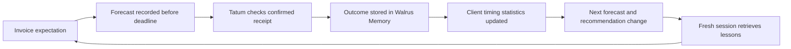
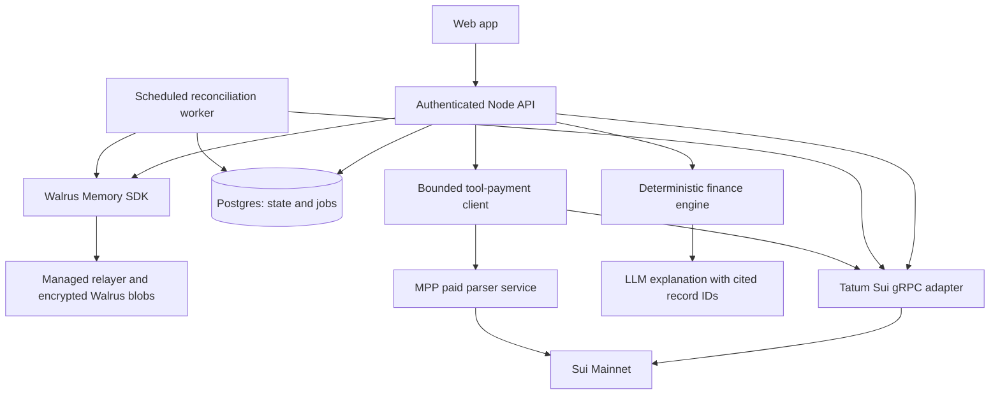

# Runway: product and technical build plan

**Runway shows which bill a delayed client payment puts at risk and the smallest permitted spending adjustment that covers it.** It learns payment timing from reconciled outcomes and shows the evidence behind every changed forecast or recommendation.

This specification assumes one experienced full-stack builder. It is a recommended build, not an implemented or live-verified application.

Implementation detail is now specified in [ARCHITECTURE.md](ARCHITECTURE.md), [DESIGN_SPEC.md](DESIGN_SPEC.md) and [IMPLEMENTATION.md](IMPLEMENTATION.md). Those files define exact engineering contracts, original UI/copy/motion/logo requirements and ordered work packages. The architecture governs implementation details when this product overview is less specific.

## The user and the job

Start with freelancers who already receive at least some invoices in USDC on Sui. They have fixed obligations, irregular receipts and client promises that do not always predict settlement. Support user-confirmed offchain invoices and obligations, but do not pretend a wallet reveals their full financial life.

The job is: **“If this client pays late again, which bill is exposed, and what is the smallest change I can make now?”** Confirmed available-to-spend and possible future income remain separate.

Interview five such users before 24 October using the [validation protocol](VALIDATION.md). The commitment gate requires at least three concrete consequential delay episodes, two usable redacted histories and two volunteers for a prototype trial. These are planned thresholds, not interviews already conducted. Have users show how they decide whether to spend today; enthusiasm for an AI demo alone is insufficient.

Use the exact target segment where possible. Broader freelancer interviews can test timing pain, but cannot validate demand for Sui settlement. If nobody accessible uses Sui, broaden the interface to user-confirmed invoices while keeping the real Sui settlement rail demonstrable and clearly label this adoption limitation.

## The minimum complete product

| Surface | User sees | Real implementation |
| --- | --- | --- |
| **Today + stress test** | Confirmed available-to-spend, separate uncertain receipts, first exposed bill/date, gap and smallest permitted adjustment. | Tatum reads; dated cash-flow engine; fixed versus flexible expense constraints; exact arithmetic. |
| **Invoices** | Due date, amount, payment window, confidence, receipt status and explanation. | Small invoice form/CSV import; exact invoice-to-receipt matching; client timing statistics. |
| **What changed** | “Four late payments move this invoice past rent. Reduce Saturday's purchase by 150 USDC to preserve your reserve.” | Linked forecast, outcome, current policy and action-plan memories; inspectable same-input comparison. |
| **Assistant** | Ask why a recommendation changed or what happens if a payment is late. | Retrieval from Walrus plus structured engine outputs; LLM explains without calculating money. |
| **Memory evidence** | Stored lessons, actual blob IDs, original record timestamps and supporting settlement digests. | Poll completed MemWal jobs; retrieve records; Tatum transaction verification; provenance distinctions. |

One background worker reconciles tracked invoices and updates the stress test. The on-demand brief explains the resulting action plan. Add one small paid tool service after core validation; scheduled briefs and autonomous tool-selection learning are stretch work.

Keep the build to one supported coin and one chain, one invoice import format, at most three tracked client addresses, a 14-day stress-test horizon, at most eight flexible expenses and four primary screens. Memory evidence is a drawer, not another full product surface. Reduce or cancel user-designated flexible expenses in the MVP; multi-invoice optimization and automatic rescheduling are deferred. Also defer bank aggregation, email OAuth, automatic client contact, merchant subscription cancellation, lending, yield farming, public wagering, token issuance, voice, mobile-native applications and a general agent marketplace.

## The hero demo

Use an explicitly labeled synthetic freelancer scenario. Imported historical records have their actual import/write time and a separate historical event time; they are never presented as Mainnet writes made months earlier.

**Fixed inputs:** On Thursday **29 October 2026**, confirmed funds are **800 USDC**, the user's reserve floor is **100 USDC**, a **250 USDC flexible purchase** is planned for Saturday **31 October**, and **600 USDC fixed rent** is due Monday **2 November**. An invoice for **1,200 USDC** is promised Friday **30 October**. The purchase may be reduced to zero by the user; rent cannot move. The horizon ends **4 November** and contains no other supplied cash flows.

**Without history:** The explicitly labeled promised-date scenario puts the invoice on Friday and the projected balance after Monday's rent at **1,150 USDC**. This is a scenario based on the client's promise, not a reliable forecast. Confirmed available-to-spend is **0 USDC**: `max(0, 800 - 250 - 600 - 100)`. The current commitment-plus-reserve shortage is **150 USDC** in either history condition. Future invoice money never becomes spendable merely because a scenario includes it.

**With history:** Four reconciled historical outcomes were **3, 4, 4 and 5 calendar days late**. Their median is four days, moving the scenario receipt to Tuesday **3 November**, with an observed arrival range of **2–4 November**, not a confidence interval. Before the median receipt, Saturday's purchase leaves **550 USDC** and Monday's rent leaves **-50 USDC**: a **50 USDC uncovered rent amount**, or **150 USDC below the user's reserve floor**. This is the first exposed fixed obligation. For unknown same-day timing, outflows precede uncertain receipts.

**Action:** “Reduce Saturday's purchase from **250 to 100 USDC**. That leaves **100 USDC** after Monday's rent even if this invoice has not arrived.” The **150 USDC reduction** is the minimum that preserves the floor under these inputs: `800 - (250 - 150) - 600 = 100`. The user reviews and confirms the change; the app records the accepted plan. No invented risk reserve or rescheduling of fixed rent is needed. The proposal alone does not edit commitments or move money.

| End of date | Promised-date scenario | History-median scenario | History-median with proposed adjustment |
| --- | ---: | ---: | ---: |
| Thu 29 Oct | 800 | 800 | 800 |
| Fri 30 Oct | 2,000 | 800 | 800 |
| Sat 31 Oct | 1,750 | 550 | 700 |
| Mon 2 Nov | 1,150 | -50 | 100 |
| Tue 3 Nov | 1,150 | 1,150 | 1,300 |

All table balances are projected USDC in a synthetic replay. The purchase adjustment is applied only in the third column. None of these anticipated receipt balances replaces a fresh confirmed-balance read.

**Fresh runtime:** Start a new authorized runtime without the prior chat or cached client history. Supply the identical current financial state, then retrieve the bounded required Walrus history. It reproduces the Tuesday estimate, Monday exposure and 150 USDC proposal. Show a correction superseding an older rule; retrieval of the obsolete rule cannot override the current version.

**Evidence:** Open the comparison and memory cards: same current inputs, different history access, exact timeline, selected records and their provenance. Then show a separate live small invoice paid through Tatum, followed by a completed outcome/lesson write. An optional 0.01 USDC parser purchase demonstrates the 402 flow. Large balances are synthetic and remain separate from the live-money panel.

If running the invoice outcome live, create a separate scaled invoice with its own matching amount and clear “live settlement exercise” label. The larger scenario is a reproducible replay and the smaller invoice is a real Mainnet test. Never mix their balances or claim simulated financial savings as customer outcomes.

## A learning loop the judge can verify



Memory provides external context and an evolving statistical record; it does not retrain the foundation model after every invoice.

Track two required adaptations: client history changes the estimated arrival window and exposed obligation; user corrections change the permitted action using the current policy version. A corrected client association must also rebuild the affected timing statistics. Tool-selection learning is stretch work and needs labeled service outcomes before any improvement claim.

For a binary forecast `paid_by_deadline`, score probability `p` against outcome `y ∈ {0,1}` with `Brier = (p - y)^2`. Preserve the forecast that existed before resolution. Example: a forecast of 0.8 and a missed deadline score 0.64; a forecast of 0.25 and a missed deadline score 0.0625. That illustrates the metric, not achieved model performance.

Use a simple disclosed prior for an initial prototype, such as `Beta(2,2)` updated by paid-by-date successes/failures. Four misses yield `2 / (2 + 2 + 4) = 0.25`. A client's promised date is a source of information, not a measured 0.8 probability. If comparing against a constant baseline, name it as an experimental baseline. With four observations, label the estimate exploratory and display sample size; do not imply statistical calibration.

Arrival dates use up to eight recent active resolved outcomes per client, with at least four required for a personalized timing estimate. Use median delay, rounding an even-sample midpoint upward to a calendar day, plus observed min/max lateness. These are not precise probabilities or confidence intervals. Pending invoices whose outcome deadline has not passed are excluded from resolved scoring. A lack of tracked receipt means “unconfirmed on this monitored rail,” not necessarily “client did not pay elsewhere.” Users resolve offchain payments separately and label the evidence source.

## Financial decision rules

Compute in integer atomic units, using the canonical coin type and verified decimals. Maintain separate account scopes so a synthetic balance, manual bank balance, coin-object balance and address balance cannot be counted twice. The current Sui SDK reports total, coin and address balances separately; use total once. [Mysten balance API](https://sdk.mystenlabs.com/sui/clients/querying).

For the selected planning horizon, include each accepted unpaid expense once, whether fixed or flexible. Pending transfers are reserved only if their obligation has not already been included:

```text
available_now = max(0,
  confirmed_unrestricted_funds
  - accepted_unpaid_expenses_in_horizon
  - user_base_reserve
  - pending_outgoing_reservations)
```

All four inputs have visible definitions and a freshness timestamp. Also display the unclamped commitment shortage so zero does not conceal a deficit. Expected receipts never increase `available_now`. Once a confirmed transfer is reflected in funds, remove the corresponding unpaid obligation/reservation atomically to avoid counting it twice. If obligations or account coverage are incomplete, the result is conditional on supplied information.

Forecast views may include possible receipts, but must separate them visually from money the user has. Learned lateness changes timing warnings and scenario actions. History does not silently change available-now or the user's reserve floor.

### Deadline stress test and bounded action engine

For each dated event, compute `projected_balance = confirmed_funds + scenario_receipts_through_event - unpaid_outflows_through_event - unmatched_pending_reservations`. Compare every prefix balance with the user-set reserve floor. Fixed obligations are always retained. Evaluate the promised-date scenario, the historical-median scenario, the latest observed delay and a no-receipt-through-horizon scenario. No-history clients show “insufficient history”; the promised-date view is a labeled comparison, not personalized learning.

Each flexible expense has a confirmed date, amount and maximum permitted reduction. Walk the timeline to the first floor breach. Use the latest still-unexecuted eligible expense at or before that breach, reduce it by up to the required deficit and its remaining permitted cap, then continue through the horizon. Tie-break equal dates by stable expense ID. Recompute all prefixes after the proposal. Because the MVP only reduces outflows and adds no new costs, this finds the minimum total reduction for a feasible selected scenario; it does not optimize utility or claim the fewest edits. The user may select another equally sized adjustment.

Show the first exposed fixed obligation, uncovered bill amount, reserve-floor gap, proposed changes, final balances and scenario assumption. If permitted reductions cannot remove every breach, report the remaining amount and “no feasible adjustment within your rules.” A proposal must never reduce rent, assume permission to delay a bill, count an already-spent purchase as adjustable, invent a fee or contact the client. The no-receipt scenario makes residual dependence on uncertain income visible.

Store a decision record containing current-state input hash, scenario/rule version, selected history IDs, reserve policy version, timeline output, proposed adjustment and acceptance status. The explanation is generated from this structured result; the LLM neither computes money nor grants permissions. Future evaluation checks both timing predictions and whether the proposed plan covers the observed timeline.

The MVP planner proposes reductions or cancellation of permitted flexible expenses. Accepting updates those commitments after version checks; it never moves funds. Savings suggestions and bill rescheduling are stretch scope. The hackathon core is advisory; the optional agent only spends from its separately funded tool wallet under an explicit small budget.

## Memory records and authoritative state

Use typed records with a schema version and deterministic identifiers:

```text
MemoryEnvelope
  schemaVersion, recordId, recordType, accountScope
  recordedAt, eventAt, sourceType, sourceReference
  invoiceId/clientId, payload, supersedesRecordId?
  integrityHash, confidenceLabel, modelOrRuleVersion
```

Record types: `user_policy`, `obligation`, `invoice_expectation`, `forecast`, `settlement_outcome`, `client_lesson`, `user_correction`, `action_plan`, `tool_receipt`, `daily_brief`, `state_snapshot`. Action plans include proposed/accepted status and the referenced financial-state version.

Normalize financial payloads before storage; preserve a brief evidence summary rather than hidden model chain-of-thought. Raw PDFs and inbox content are unnecessary for the memory loop. Store client aliases rather than identity documents. Synthetic examples use distinct namespaces/accounts from any personal records.

Postgres holds the exact current state, receipt deduplication, worker cursors, jobs and payment budget reservations. Walrus Memory holds selected durable outcomes, lessons, corrections and action records, plus recovery snapshots if that optional feature is built. Money is verified against fresh Tatum reads; the database and memory never outrank chain settlement evidence.

A new policy supersedes an older policy with an explicit version. Relevance-ranked recall can return an older, better-worded record; even `sort: recent` considers a bounded semantic candidate set. Do not select current policy by taking the newest result among a few recalled memories. [MemWal API ordering](https://docs.wal.app/walrus-memory/sdk/api-reference).

For required fresh-runtime continuity, supply the same authoritative current state and retrieve a bounded, known history manifest of no more than 30 required records. Verify the required IDs, contents and supersession versions; absent records produce “history incomplete,” not a false no-history success. Do not quietly supply Postgres historical outcomes in the Walrus condition.

Full financial-state recovery is optional. If built, include structured state snapshots and referenced IDs. After `restore`, paginate `listMemories` metadata, recall the bounded content set, and verify every required ID and version before reconstruction. Missing content stops reconstruction. Do not claim `restore` returns all plaintext records; it repairs the relayer index. Do not erase or manipulate the managed relayer database for the demo.

At larger scale, compact into versioned snapshots and design exact export/retrieval separately. A semantic API is not a transaction ledger. The required MVP proves cross-session history continuity; optional bounded recovery needs its own completeness checks before any recovery claim.

## Mainnet memory evidence

The [official SDK](https://docs.wal.app/walrus-memory/getting-started/quick-start) uses `@mysten-incubation/memwal` with the production relayer `https://relayer.memory.walrus.xyz`. Configure delegate key and account ID from secure environment variables.

For every write: persist logical record ID → submit `remember` → persist job ID → poll terminal state → save returned blob ID → confirm recall and returned ID/content. An accepted job is not a completed memory. Recover a timed-out job by its ID before deciding to resubmit. The app's deterministic record ID handles duplicate outcomes when upstream deduplication is unavailable.

Aim for **20–30 useful completed Mainnet memories**, including at least 10 easily inspectable distinct records. A planned allocation is: 4 policy/obligation records, 4 historical outcomes, 3 pre-resolution forecasts, 3 live or replay-labeled outcomes, 3 revised lessons, 2 corrections and 3 proposed/accepted action records: **22 records**. Optional tool receipts or snapshots may add records. Report actual completed records and provenance rather than padding writes.

Show record ID, write time, event time, job status, blob ID and the reason that record affects the product. Tatum can verify relevant Sui objects/transactions where their references are available; the SDK result itself may not supply an upload transaction digest. Do not invent one. Encrypted blob availability is verifiable separately from authorized plaintext recall, and neither establishes truth of an imported invoice.

Retain storage through the judging window and beyond the announcement, checking actual expiration metadata and hosted-relayer retention. Ten successfully uploaded memories that expire before judging do not provide a usable demo.

## Architecture



The default stack is TypeScript, React/Vite, React Router, TanStack Query, a Fastify Node API/worker, Postgres/Drizzle, the MemWal SDK, current Mysten Sui/dApp Kit packages and one structured-output explanation model with deterministic fallback. [ARCHITECTURE.md](ARCHITECTURE.md) defines module boundaries and deployable defaults. AI Builder may determine the shell only if its primarily-built eligibility and maintainable server integration are verified.

Use `SuiGrpcClient` with a native transport when possible, injecting Tatum's `x-api-key` metadata server-side at `sui-mainnet-grpc.gateway.tatum.io:443`. First smoke-test native transport and authenticated balance/transaction calls; the SDK's default transport speaks gRPC-web and should not be assumed compatible. [Mysten transport documentation](https://sdk.mystenlabs.com/sui/clients/grpc), [Tatum gRPC guide](https://docs.tatum.io/reference/sui-grpc).

If the native SDK transport has compatibility trouble, use `@grpc/grpc-js` and the official proto service definitions behind a small typed adapter. Lock versions and actual method names after the spike. Tatum's guides contain different service/method mappings across pages; successful runtime calls and proto definitions settle the implementation detail.

## Tatum does real work

| Operation | Why the product needs it | Proof |
| --- | --- | --- |
| Get current USDC balance | Show money actually available and reconcile coin/address balances. | Response timestamp, chain/network and sanitized adapter trace. |
| Get a transaction by digest | Confirm received amount/token/sender and successful execution. | Digest linked to explorer and normalized matching result. |
| Bounded tracked-client history or checkpoint tail | Find new candidate payments after reconnect/worker restart. | Durable cursor, processed checkpoint range and deduplication counts. |
| Re-read a paid tool transfer | Establish actual Sui settlement before marking the service paid. | Exact amount/recipient/token and verified transaction status. |

For MVP ingestion, known client sender addresses and a user-provided digest are acceptable. Do not depend on an undocumented receiver-history filter. The current shared SDK transaction-history filters are limited; richer queries may require raw gRPC history services, checkpoint processing or a verified supported Data API. [Current query/filter documentation](https://sdk.mystenlabs.com/sui/clients/querying).

Persist only bounded relevant history; never scan all Mainnet. Enable automatic discovery only after the supported method/cursor and measured call budget pass the early spike. If those gates fail, ship known-digest verification and remove automatic-monitoring claims. “Monitor this invoice” does not mean “index every transaction of every wallet.”

Matching requires correct chain, canonical token type, success, recipient, received amount, timing and invoice association. Exact amount/sender alone may be ambiguous; if two invoices qualify, ask the user to choose. Support partial payments by summing distinct confirmed receipt allocations; do not mark an invoice paid until the required amount is covered. A Sui transaction can include unrelated operations, so use actual balance effects or decoded transfers and distinguish receipt amount from gas effects.

Stale RPC data produces a stale indicator and suspends fresh monetary recommendations or spending. Do not turn an upstream outage into a fabricated success or silently route sponsor evidence through a public node. A contingency provider must be clearly labeled and cannot count as a Tatum integration demonstration.

## Ownership and privacy

Start with a clearly described operator-managed demo account containing synthetic data and authenticated per-user namespaces. Namespaces provide logical isolation; the account operator still owns the memory. Derive namespace server-side from authenticated identity. Never accept an arbitrary namespace/account scope from the browser.

For a genuine personal-memory portability claim, add a user-owned MemWal account connection and registered delegate flow after the core demo works. Demonstrate it with a dedicated builder-owned account and two authorized runtimes. A delegate key gives memory permissions, not access to the user's primary spending key. Verify actual delegate scope in the deployed contract rather than assuming namespace-level onchain enforcement.

The default managed relayer and chosen model may see plaintext. Disclose that boundary if collecting real records. [Walrus relayer trust boundary](https://docs.wal.app/walrus-memory/relayer/overview). Keep demo evidence public only for synthetic/consented records. The authenticated memory inspector can show private records without exposing them to the public submission repository.

Use versioned corrections and retention metadata. Current docs offer owner-authorized deletion, but deployment availability must be verified and deletion cannot revoke copies already downloaded by authorized clients. [Deletion flow](https://docs.wal.app/walrus-memory/guides/delete-memories-programmatically).

## Agent payments: a small real economic action

Add an invoice-parsing service with a documented 0.01 USDC price. The agent can parse a text/PDF invoice into validated amount, due date and client reference, then save the user-confirmed expectation. This is useful work in the finance workflow, not a circular transfer presented as adoption.

A controlled service operated by the builder is acceptable as a protocol demonstration if disclosed. It is not evidence of a third-party commercial marketplace. Manual invoice entry remains available. Store service URL, price, output hash, user correction/result and settlement digest so later service-quality memories have actual evidence.

Implement one protocol, preferably the [Sui MPP reference implementation](https://suimpp.dev/docs), after confirming organizer acceptance. Flow: request → real HTTP 402 challenge → validate price/network/token/recipient → atomically reserve budget → sign payment → wait for success → retry with bound credential → receive parser result and payment receipt → Tatum re-verifies settlement → save memory.

The inspected suimpp client accepts a supplied Sui Core API client, while its server constructs its own `SuiGrpcClient` from `rpcUrl` and does not expose an obvious custom auth transport option. Supplying a Tatum URL alone may fail authentication. Spike a local authenticated gRPC-web-to-native bridge or a minimal audited transport extension if the server verification must route through Tatum; otherwise disclose server-provider verification and independently re-verify through the application Tatum adapter. Keep all credentials server-side.

Tool wallet rules: separately funded, no primary user key, small total balance, 0.05 USDC maximum per call, 0.20 USDC daily budget, allowlisted service and recipient, canonical USDC, explicit user-set limits, and concurrent-call budget reservations in Postgres. Threshold values are proposal defaults, not security enforced by the chain. Unless a scoped onchain wallet is implemented, the demo wallet's small balance is the hard financial boundary and server policy remains trusted.

The payment server needs durable replay/digest protection across restarts. Audit the implementation's `has`/`set` sequence; a database unique key alone may not serialize simultaneous requests if the check happens before the handler. Use transaction/locking semantics or a claim mechanism so a settled digest cannot unlock multiple jobs. Bind challenge, amount, currency, recipient and request identity. Persist paid job results so a lost HTTP response can be recovered without repaying.

Payments can settle even when a downstream parser fails. Mark the service job failed after payment, retain its digest, and retry/recover the same paid job instead of buying again. Do not imply the transfer and external tool output are an atomic transaction.

Sui gasless stablecoin transfers have a 0.01 minimum and narrow operation requirements. A separate Move receipt cannot be bundled into that gasless shape. Use payment digests and Walrus records for MVP; an optional custom forecast commitment contract is a stretch only after everything else is verified. [Sui gasless rules](https://www.docs.sui.io/develop/transaction-payment/gasless-stablecoin-transfers).

## Evaluate improvement honestly

Execute the [validation protocol](VALIDATION.md). Prepare a labeled chronological dataset and replay it without future information. Split by time, not random invoice rows that leak a client's later behavior. Compare the promised-date scenario and empirical timing model; assess history delivery independently. Freeze current obligations, balances, policy, model, prompt and engine version for each comparison.

Compare no-history, Walrus-history and equivalent Postgres-history conditions. Change only access to prior outcomes; omit past chat and hidden history caches. Postgres and Walrus must yield identical deterministic outputs when their records match. This separates useful historical evidence from its transport and proves continuity without claiming Walrus intrinsically forecasts better than the same data in a database.

Measure lateness absolute error, exposed-obligation detection, actual-timeline reserve breaches and total proposed reductions. Always-deferral can reduce breaches at unnecessary cost, so report both coverage and adjustment cost. Add paid-by-date Brier where a comparable probability baseline is explicitly defined, correct citations/policy versions, repeated corrections, duplicate receipts, completed memory count and optional payment success. Publish sample sizes and counterexamples. Report synthetic replay, consented historical replay and live integration results separately.

[LongMemEval](https://arxiv.org/abs/2410.10813) evaluates extraction, multi-session reasoning, temporal reasoning, updates and abstention. Use those categories to design product-specific cases; this small app evaluation does not reproduce that benchmark or support a state-of-the-art memory claim.

Required acceptance cases: late and punctual client, new client with sparse history, corrected policy/client association, feasible/infeasible adjustment, reserve-floor versus bill gap, outflow before same-day uncertain receipt, no-receipt stress, wrong token/recipient, duplicate/partial payment, ambiguous match, stale RPC, unfinished memory, missing required history, cross-user isolation and invoice prompt injection. Add missing recovery record if recovery is built; simultaneous paid calls, reused digest and timeout after payment if payments are built.

## The 2–3 minute presentation

| Time | Demonstration |
| --- | --- |
| 0:00–0:20 | A consented user episode and actual validation count; distinguish it from the synthetic replay. |
| 0:20–0:55 | Same-input comparison: Friday promise versus Tuesday history; Monday rent exposure and exact 150 USDC adjustment. |
| 0:55–1:20 | Inspect the timeline and references; confirm a flexible-spend proposal while rent stays fixed. |
| 1:20–1:45 | Fresh runtime recalls the same records; a corrected rule supersedes the old one. |
| 1:45–2:10 | Separate live small invoice: Tatum receipt verification and completed Mainnet outcome/lesson. |
| 2:10–2:30 | Optional 402 → Sui payment → parser output; otherwise use the time for the controlled evaluation. |
| 2:30–2:50 | Actual evaluation counts/results, remaining limits and the user promise. |

Use a pre-recorded full successful live flow if background writes are slow, while keeping a working app and verifiable IDs available. Label every replay. A judge should be able to understand the product without watching a terminal; the evidence panel exists for inspection after the user story is clear.
