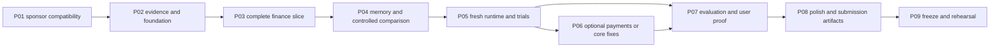

# Runway implementation work packages

Original plan: 21 October 2026. Delivery status reconciled: 23 October 2026. The work packages below retain the original requirements and estimates; verified delivery status is recorded here. Read [ARCHITECTURE.md](ARCHITECTURE.md), [DESIGN_SPEC.md](DESIGN_SPEC.md) and [VALIDATION.md](VALIDATION.md) before starting. Maintain the ignored root `TASKS.md` with actual work, changed files, verification and exact next step.

## Verified delivery status

The core application and optional invoice tools are implemented. The current source passes all 69 domain/integration tests and eight browser journeys. Node 22 is required; the shell's older Node 20 cannot run the PDF and current CommonJS/ESM dependencies correctly.

| Package | Delivered implementation                                                                                    | Remaining acceptance dependency                                                                                             |
| ------- | ----------------------------------------------------------------------------------------------------------- | --------------------------------------------------------------------------------------------------------------------------- |
| P01     | Authenticated Tatum reads, Walrus write/recall, versioned compatibility evidence.                           | Recheck remote availability through judging.                                                                                |
| P02     | Original brand, responsive interface, exact domain model and optimizer.                                     | Actual interviews and consented histories.                                                                                  |
| P03     | Scoped wallet/sample sessions, finance forms, CSV, plans, review/save, receipt verification and allocation. | Owner-signed allocation of the builder's known receipt.                                                                     |
| P04     | Durable jobs/outbox, thirteen synthetic Mainnet records, corrections and controlled parity.                 | Personal publication only after content choice and consent.                                                                 |
| P05     | Restart recovery, export/rebuild, scoped recall and fresh-process parity.                                   | Observed target-user trials.                                                                                                |
| P06     | Bounded invoice extraction, actual MPP protocol, budgets, approval and same-operation recovery.             | Funded tool wallet and a user-approved Mainnet purchase.                                                                    |
| P07     | Frozen temporal evaluation, full adverse results and reliability checks.                                    | Real consented held-out histories and three observed trials.                                                                |
| P08     | Brand assets, hosted app, build story and actual-browser demo.                                              | English male narrated actual-browser demo rendered with Remotion; media verification tracked in the ignored root checklist. |
| P09     | Public app/source/evidence and prepared submission package.                                                 | Builder identity, eligibility review, terms and final submission.                                                           |

These dependencies do not justify claiming user validation, personal consent or a funded purchase. [HANDOFF.md](docs/HANDOFF.md) gives the concrete owner actions. Client Memory plugin installation is a separate reported marketplace failure, not an app implementation gap.

## 1. How to execute this plan

Work in thin vertical slices: save a fact, verify it, render it, handle its failure, then polish the interaction. Each package has a tangible artifact and an acceptance gate. Sponsor SDK details must pass the first spike before dependent code is built. Visual composition and motion begin early alongside the domain foundation; the frontend is not postponed to video week.

The planned capacity remains **120 focused hours plus 20 hours contingency**. This is an estimate for an experienced builder and does not guarantee the complete specification fits an unknown team. Required financial correctness, sponsor evidence and UI quality outrank optional payments, broad recovery and general chat. If a gate slips, use the documented cuts instead of rushing acceptance.

No package is finished because its files exist. Mark it complete only when the stated behavior and relevant verification pass. Do not publish, fund accounts or send external messages as a side effect of planning; those are future build actions in the user's authorized scope.

### Requirement trace

| ID  | Requirement                                                     | Package        | Evidence                                                                        |
| --- | --------------------------------------------------------------- | -------------- | ------------------------------------------------------------------------------- |
| R01 | Original professional responsive frontend and motion.           | P02, P03, P08. | Landing/app screenshots, browser motion checks and human craft review.          |
| R02 | Original logo throughout app including browser/shortcut assets. | P02, P08.      | SVG/raster exports, actual tab/manifest screenshots and route branding.         |
| R03 | Human product copy, no em dashes/emoji, grammatical hyphens.    | P02, P08.      | Copy registry/lint plus human read-through and trial feedback.                  |
| R04 | Wallet auth and private workspace isolation.                    | P03, P05.      | Personal-message challenge, nonce replay/CSRF/cross-scope tests.                |
| R05 | Exact funds, dates, expense rules and minimal reduction.        | P02, P03.      | Hero fixture, domain/property tests and permitted/infeasible action cases.      |
| R06 | Meaningful authenticated Tatum Mainnet reads.                   | P01, P03.      | Successful transport, actual balance/receipt data and routed adapter trace.     |
| R07 | Ten or more completed Mainnet Memory records.                   | P01, P04.      | Saved job/blob IDs, metadata count and content-matching recall.                 |
| R08 | Controlled A/B/C memory proof and fresh continuity.             | P04, P05.      | Equal current-input hashes, equivalent history/output and fresh process export. |
| R09 | Current correction replaces obsolete rule/outcome.              | P04, P05.      | Corrected reserve/client fixture, supersession evidence and updated result.     |
| R10 | Real target-user evidence and usable action.                    | P02, P05, P07. | Anonymized episodes/histories, trial outcomes and retested feedback.            |
| R11 | Reliable priced Sui MPP service if submitted.                   | P06.           | Actual protocol/payment/output and failure/concurrency verification.            |
| R12 | Reproducible hosted submission and presentation.                | P08, P09.      | Fresh clone/build, accessible demo/repo/blog/video and actual source evidence.  |

## 2. P01: integration and compatibility gate

Dates **21–22 October**, **8h**. Depends on secure builder accounts and an approved actual capacity/budget. It blocks sponsor-dependent development.

1. Initialize pnpm workspace and Node/TypeScript config. Create server/domain/contracts skeleton and a secure env schema. No keys enter frontend env, git files, logs or checklist.
2. Record current compatible package versions/engines. Resolve dApp Kit's new core/React packages and the tested Sui client/proto set.
3. Implement a minimal Node Tatum adapter with TLS/native HTTP/2 and `x-api-key`. Perform service/checkpoint, canonical-USDC metadata/balance and known small transaction reads. Save sanitized provider, status, fields and timestamps.
4. Verify the transaction field mask returns enough status/effects to prove receipt facts. Reject digest-only results. Confirm total balance is used once.
5. Probe bounded sender/history support with a strict call ceiling. Record supported methods, cursor semantics and cost. Choose known-digest core plus the actually viable discovery path; do not promise global monitoring.
6. Configure MemWal through the production relayer. Call compatibility and a signed remember with a synthetic structured record.
7. Persist the accepted job ID, poll until done, save the actual blob ID and verify plaintext schema/hash through recall. Inspect list pagination/retention metadata. Unsigned health alone does not pass.
8. Write `docs/integration-compatibility.md` and `docs/integration-gate.json` with actual versions, supported calls, IDs/source labels and failures, excluding secrets. Lock dependencies.

Outputs: initial workspace, adapter interfaces, reproducible small smoke scripts, compatibility evidence and concrete discovery choice. Acceptance: both authenticated sponsor paths work on Mainnet and one memory is completed/recalled. If either fails, fix this gate before adding screens. Optional MPP receives no more than a two-hour feasibility probe in P02.

## 3. P02: evidence, visual foundation and exact prototype

Dates **23–24 October**, **14h**. Depends on P01 transport choices; interview recruiting begins during P01.

Allocate about **4h research**, **4h brand/layout/motion foundation**, **4h domain/contracts prototype**, and **up to 2h optional MPP feasibility**. If not pursuing payments, use its two hours for the frontend foundation and user records. Interview scheduling delay is tracked separately, not hidden as productive time.

1. Conduct the five interviews using the fixed script. Record anonymized actual segment, episode, consequence, permitted expenses, consent and history availability. Seek at least five resolved invoices per usable client for a four-outcome forecast plus a held-out outcome; eight is better if available. Four observations suffice only for the descriptive hero, not a convincing held-out improvement claim.
2. Apply the three-episode/two-history/two-volunteer gate. Request a third trial participant. Keep raw records private, do not publish them to memory without separate informed consent.
3. Create the original logo master/lockup; verify 16/20/24/32 px optical behavior and reserve export tasks. Define CSS tokens/fonts/licenses and a typed copy registry.
4. Build landing composition and app shell using deterministic fixture data. Review 1440/390/320 px before coding additional feature screens. Create the static payment orbit and caption first; wire controlled animation afterward.
5. Implement money/date helpers, Zod DTOs and the exact hero fixture with injected 29 October clock. Prototype promised/history/no-receipt timeline and 150 reduction.
6. Add minimal/infeasible reserve/cap cases and brute-force comparison tests for the optimizer. Current spendable cash must be zero in every history condition; sample action acceptance must not create funds.
7. If pursuing MPP, cap the probe at two hours. Verify actual challenge/payment/output feasibility, transport and funding needs without treating it as production reliability. Save the operation/digest if any; abandon mandatory payment scope on failure.

Outputs: actual evidence notes, design foundation, logo master, local fixture-driven landing/shell and pure-engine prototype. Acceptance: precise arithmetic/constraints pass; the proposed layout is visibly deliberate and works on a phone; gate outcome recorded. No architecture feature claims count as user validation.

## 4. P03: complete finance slice and live receipt

Dates **25–27 October**, **20h**. Depends on P01 and the P02 direction/evidence gate. Suggested split **10h server/database**, **8h feature UI**, **2h focused verification**.

1. Create identity/session/current-finance migrations, composite tenant keys and versioned policy/accounts/clients/invoices/expenses. Implement scoped transaction services and request idempotency.
2. Implement wallet challenge/verify/logout, nonce single-use, origin/network/address binding, cookie/CSRF and unsupported-signature behavior. Add isolated sample session/reset and guest limits.
3. Implement bootstrap/account reads, balance refresh job and explicit manual account confirmation. Render Overview current-funds equation, shortage and expected-income separation.
4. Wire invoice/expense forms with actual DTO validation, expected version and specific errors. Fixed expense caps are zero; flexible caps are reviewable. Add CSV preview/confirm only after manual entry works.
5. Complete the pure planner for all four scenarios, opening/overdue rules, same-day ordering, sparse history, minimal allowed reductions and residual infeasibility. API persists immutable input/result snapshots.
6. Render the Plan timeline/table, exposure statement and review drawer. Implement accept/reject under workspace/expense locks; duplicate acceptance is idempotent, stale version returns conflict. A proposal does not alter the displayed accepted commitment.
7. Implement receipt verification job, exact Tatum facts, allocation locks/partials/ambiguity and outcome creation. Use a real small builder invoice with matching amount; keep it distinct from the large synthetic fixture.
8. Implement bounded automatic discovery only if P01 support/budget passed. Otherwise digest checking is the submitted path and all copy reflects it.
9. Add activity audit rows and user-facing jobs/freshness. Refresh/reload preserves state; wallet switch clears private caches. Do not optimistic-update a balance or successful receipt.
10. Verify integer/date fixtures, allocation dedupe, stale acceptance, tenant access, nonce reuse and the critical browser save/reload journey. Record real receipt digest and safe trace.

Outputs: a complete useable finance app using current state, reviewable adjustments and Tatum receipt verification. Acceptance: sample path works without wallet; personal path is scoped; exact action passes; one real receipt verifies correctly; failure states remain usable. If this is incomplete by 27 October, cut CSV/discovery/general chat before cutting correctness or UI quality.

## 5. P04: durable memory and controlled decision evidence

Dates **28–30 October**, **20h**. Depends on the finance slice and successful P01 MemWal calls. Suggested split **12h backend/jobs**, **6h evidence/explanation UI**, **2h focused comparison verification**.

1. Add immutable memory/outbox/attempt/manifest tables and leased job handlers. Commands append facts and outbox together; no remote calls run inside a money transaction.
2. Implement deterministic summaries plus canonical envelope parsing/hash validation. Store record IDs in payloads, not assumed SDK fields. Version user policy/outcome/client corrections explicitly.
3. Implement accepted-job polling, save blob IDs, metadata count and content verification. Resume known jobs after restart; unknown submission gets explicit reconciliation rather than blind repeated writes.
4. Publish useful fixture expectations/outcomes/policies/lessons/actions. Target the planned 22 logical records and at least ten completed/recalled records. Actual count/provenance may differ; no padding or old Mainnet write timestamps.
5. Implement bounded full-required-history loading, validation/supersession and incomplete-history state. Do not use semantic newest-wins or metadata as plaintext export.
6. Create A/B/C fixture runners: no prior outcomes, Walrus-recalled outcomes, identical Postgres outcomes. Freeze current-state hash/clock/model/engine; include no hidden chat/history cache.
7. Compare deterministic results excluding transport labels. Walrus/Postgres must match normalized history/output. No-history client-date scenario is labeled naive; no-receipt arithmetic remains available in every condition.
8. Implement in-context memory drawer, source labels and exact before/after timeline. Every meaningful decision points to selected IDs/current rules. LLM adapter explains a PlanResult; template fallback is always functional.
9. Add consent/public sample-write limits. Anonymous visitors only read curated synthetic evidence; real-record publication requires informed consent.
10. Verify memory failures, incomplete sets, stale superseded policy, duplicate logical records and the exact 150 action. Export actual comparison evidence and completed-record manifest.

Outputs: deep outcome-to-next-decision loop with durable evidence, inspector and reproducible comparison. Acceptance: ten or more real completed memories, matching recall, actual history-caused timing/exposure and B/C parity. Stop optional work until this passes. General assistant breadth is not a substitute.

## 6. P05: fresh runtime, corrections and initial user trials

Dates **31 October–2 November**, **14h**. Depends on P04. Suggested split **6h continuity/correction/reliability**, **4h trials/feedback**, **4h UI refinements and retest**.

1. Start a new authorized process/session without cached history or old chat. Supply the identical current financial state and bounded manifest only.
2. Recall histories through Walrus and reproduce Tuesday estimate/Monday exposure/150 proposal. Save current/history hashes and result. Current-state Postgres access is allowed; hidden Postgres historical outcomes are not.
3. Run reserve correction 100→50, cap correction and client-association correction. When old/new records are recalled together, current versions govern; affected sample stats change correctly.
4. Test cross-user reads, session/wallet changes, worker lease/restart, stale RPC and lost job response. Missing required memory stays visible and never produces a false complete-memory badge.
5. Observe the first two volunteers using their permitted redacted episodes or labeled fixtures. They identify bill/date, distinguish funds from forecast, choose a feasible allowed action and explain why history changed it without coaching.
6. Record missed constraints or misleading copy. Fix material issues and retest the affected task; do not record only praise.
7. Complete key loading/empty/error/conflict states and mobile keyboard/focus interactions. Review the motion against the source benchmark on an actual browser.
8. Keep broad state recovery and user-owned account setup optional. If not done, remove those claims; the builder-owned authorized fresh-session proof and honest operator-managed mode are sufficient.

Outputs: fresh continuity evidence, correction reliability and trial notes/fixes. Acceptance: same deterministic plan from fresh recall, active correction applied, usable app in failure states and material initial feedback addressed. This gate controls whether payment work receives time.

## 7. P06: conditional payments or core improvement

Implementation update, 22 October: the user explicitly requested this optional package before the original dependency gates completed. The bounded invoice agent, actual Sui MPP exchange, separate-wallet budget reservations, durable paid-job recovery, text/PDF extraction and draft confirmation are implemented. Local tests use injected chain settlement and real reference-client credentials; live funded acceptance remains open. See [configuration and recovery](docs/INVOICE_AGENT.md). The original conditional schedule below remains historical planning context.

Dates **3–4 November**, **8h**. Depends on P05 passing and P02 payment feasibility. If those gates fail, spend the full block on evidence/UI/reliability rather than adding payments.

Payment sequence:

1. Implement quote/approval/order status with exact price/network/service/recipient disclosure. Manual entry stays available; public guests cannot spend the funded wallet.
2. Add isolated tool-policy/budget/order migrations with wallet/day locking and reservation states. Daily rollover and simultaneous approvals cannot bypass limits.
3. Use actual MPP challenge/credential handling. Serialize tool-wallet signing, persist prepared-operation IDs and verify uncertain settlement before another payment.
4. Implement durable parser paid-job claim/result/retry semantics; one credential/request cannot run duplicate paid jobs. Different request content with the same credential is rejected.
5. Receive useful parsed draft, let the user correct/confirm it, and save tool-receipt memory with result hash and actual digest. Do not treat service payment as user adoption.
6. Tatum independently re-verifies exact payment settlement. Save provider/transport differences honestly.
7. Verify concurrent budgets, reused payment, lost response, service failure after payment and timeout/restart. Show real 402/payment/output in the app, not just a terminal transfer.

Acceptance: full useful flow plus failure/concurrency checks within the allocation. Otherwise disable UI/routes, omit award claim and use manual entry. Do not keep a half-built bonus in the demo. The eight-hour estimate assumes the reference path and earlier spike worked; an unfamiliar transport bridge can consume more than this block and should trigger the cut.

## 8. P07: held-out evaluation and final user evidence

Dates **5–6 November**, **12h**. Depends on a stable core; payment success is not required. Suggested split **5h replay**, **3h third trial/retest**, **4h reliability/UX issues**.

1. Freeze temporal split/engine version before evaluating. Use only outcomes resolved before each forecast; preserve prior forecasts as immutable records.
2. Replay every usable consented history plus labeled synthetic punctual/late/sparse/correction trajectories. Do not select only favorable events or leak later client behavior.
3. Report delay error against promised-date baseline, exposure detection, observed reserve breaches and adjustment amounts. Brier only when comparable probability baseline/resolution exists. A safe always-deferral policy must expose its extra restriction cost.
4. Confirm A/B/C parity and deterministic same-input comparison in the deployed-like environment. Exact fixtures pass including opening deficit, cap infeasibility and same-day ordering.
5. Run third observed trial and retest material feedback. Require two of three uncoached task successes and explicit funds/forecast understanding. Record count/source/limitations.
6. Export `docs/evaluation.md` and machine-readable results with sample sizes, source labels and all failed cases. If held-out histories are too small, say so and avoid generalized accuracy/savings claims.
7. Close critical financial, auth, copy and mobile issues. A person mistaking forecast income for spendable cash blocks release until fixed.

Acceptance: all critical invariant cases pass, actual user evidence reported and honest held-out results available. Forecast failure triggers a candid reduced claim or model revision using development data, never test-set tuning disguised as a fresh evaluation.

## 9. P08: visual finish, deployment and presentation

Dates **7–8 November**, **16h**. Depends on P07 stable behavior. Suggested split **6h frontend finish**, **4h deployment/verification**, **6h blog/video/repo**. Frontend work already happened in P02–P05; this block finishes it.

1. Finish original logo/favicon/manifest/social assets and wire brand/title across all routes/errors. Verify actual browser-tab/bookmark/shortcut behavior where supported.
2. Review landing and app at 1440/1024/768/390/320 px. Fix spacing, columns, text wrap, CTA visibility, drawer focus and bottom-navigation clearance. Compare craft with reference, without reproducing its design.
3. Finish orbit lifecycle/pause/reduced-motion and static fallback. Verify offscreen/hidden suspension, one loop and no blocked touch scroll. Record actual timings/performance rather than assumed budgets.
4. Run copy lint and human read-through: no authored em dashes/emoji, appropriate grammar/hyphens, actual feature claims only. Check product monetary copy against the engine, including after acceptance.
5. Build versioned Docker image/static assets and apply migrations to staging, then planned production. Keep secrets in secure host config. Configure same-origin routes, health/worker heartbeat, cookies/TLS, caching and allowed source origins.
6. Verify fresh setup, smoke Tatum and MemWal, realistic restart and required-memory retention through judging. Curated public evidence contains no private user records.
7. Create public README/setup/env documentation and blog draft with real evidence/results. Remove unfinished capabilities. Publication uses actual final URLs after the builder performs authorized publishing.
8. Record the 2–3 minute story from BUILD_PLAN: user episode, exact dated action, source/correction/fresh session, real small settlement, optional paid parser, measured results. Slow background flows can use labeled recordings with inspectable actual IDs and a working app.

Acceptance: deployed-like/browser verification passes, brand/assets/copy professional, final artifacts accurate and submission links ready. Do not describe planning documents or static screenshots as a working app.

## 10. P09: freeze and submission rehearsal

Date **9 November**, **8h**. Final **10 November** is the existing emergency/submission margin, not another feature sprint.

1. Feature freeze. Resolve only release-blocking issues with appropriate reruns; no optional addition.
2. Fresh clone/install/migrate/build/run with published instructions and example env names. Check secrets/agent files/checklist never staged or exported.
3. Open demo/blog/video/repository without the builder's login. Sample loads, source proof is accessible, private workspaces remain private and public reset does not mutate Mainnet history.
4. Recheck official form/rules, one submission, primary track and resolved/disclosed organizer ambiguities. Prepare Tatum dashboard ID, Sui address and delegate public key. No private keys in form.
5. Confirm actual completed memory count/expiry, Tatum path, optional payment/AI Builder eligibility and final video length.
6. Complete full rehearsal and capture actual source IDs, deployment revision and retention settings in durable recovery notes. Submit the completed project by 9 November target or before **10 November 17:00 UTC / 18:00 Lagos**.

Acceptance: a reviewer can reproduce and understand the submitted final behavior. Retain submission confirmation and keep hosting/memory available through 11–16 November judging and 17 November announcement. Do not mark submitted/deployed in TASKS.md before those operations actually complete.

## 11. Dependency and capacity summary

| Package   |   Hours |
| --------- | ------: |
| P01       |       8 |
| P02       |      14 |
| P03       |      20 |
| P04       |      20 |
| P05       |      14 |
| P06       |       8 |
| P07       |      12 |
| P08       |      16 |
| P09       |       8 |
| **Total** | **120** |

Cuts in order: P06 payments, full recovery/user-owned registration, scheduled briefs, automatic discovery beyond verified digests, CSV/PDF import, unrestricted assistant chat and dark theme. Keep professional responsive screens, original circle motion/static fallback, logo assets, exact planner, scoped auth, meaningful sponsor reads, ten completed memories, correction/continuity, user trials and clear presentation.

If capacity is under 80 hours, replace optional modules with manual entry/digest checks, use the explanation template, and reduce secondary screens while preserving design quality. Do not promise the whole 120-hour specification can fit by merely working faster. Adjust DELIVERY.md and TASKS.md to actual capacity and explain any material scope loss.

## 12. Definition of complete

Implementation is complete only when core workflows pass their domain/concurrency/browser checks, actual Mainnet sponsor proof exists, the frontend meets the original design specification, and the final submitted claims match measured behavior. The 9/10 competitiveness target also requires the actual validation gates. A flawless outcome cannot be declared from an architecture document; this plan supplies the constraints and evidence necessary to catch failures before judging.
